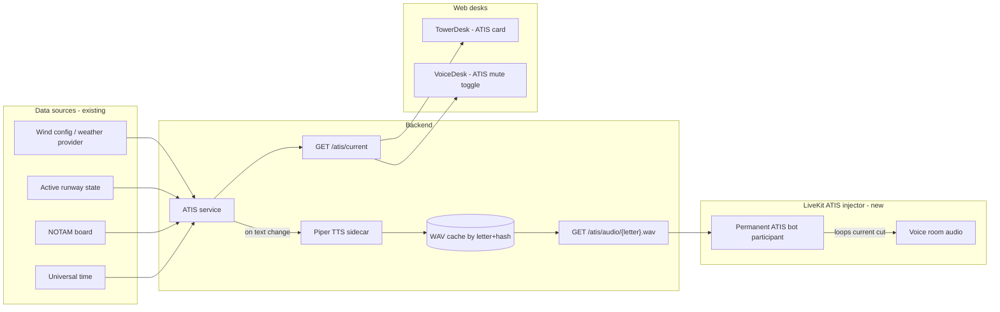

# ATIS Broadcast Loop - Plan

> **World scoping:** ATIS is `(worldId, airportId)`-scoped per [WORLD_AND_TIME_MODEL.md](WORLD_AND_TIME_MODEL.md). One bot instance per airport, joining its own `freq-atis-{worldId}-{airportId}` room. The "Time one-three-four-two Zulu" line uses the **subject airport's** in-game UT, not server wall-clock - each broadcast is in its own world's time. Weather + active runway pulled from world-scoped state. Multiple bots run simultaneously without collision.

## Purpose

Auto-generated, looping **weather observation** broadcast on the voice bridge (no fake tower clearances): `"Kerbin Space Center information Alpha. Time one-three-four-two Zulu. Wind two-seven-zero at eight. Visibility one-zero statute miles. … Altimeter two-niner-niner-two."` Optional NOTAM line when the NOTAM board has text.

Lifted from [ROLEPLAY_FEATURES_CATALOG.md](ROLEPLAY_FEATURES_CATALOG.md) section 1.2 into its own plan because it spans backend service, TTS sidecar, voice bridge integration, and web UI.

---

## Design intent

Real-world D-ATIS sounds robotic on purpose - 1990s-era concatenative synthesis, monotone, weird pacing on numbers, audible chunk seams. We are not trying to escape that aesthetic, we are leaning into it. The system should sound like an automated airport broadcast, not a voice assistant.

This drives the TTS choice: **local Piper TTS**, not cloud. Free, ~75 MB model, deliberately limited prosody, ~0.2x realtime CPU render, lands in the "airport automation" sweet spot before any DSP is applied. After the existing Kerbalizer chain in [KerbalizerControls.tsx](web/src/audio/KerbalizerControls.tsx) adds radio bandpass + compander, it will sound more authentic than premium cloud TTS would.

Cross-references: [ROLEPLAY_FEATURES_CATALOG.md](ROLEPLAY_FEATURES_CATALOG.md) section 1.2 (entry); [VOICE_IMPLEMENTATION_PLAN.md](VOICE_IMPLEMENTATION_PLAN.md) (voice bridge / Kerbalizer); [REAL_TOWER_ROADMAP.md](REAL_TOWER_ROADMAP.md) section 1 (voice reliability); [TELEMETRY_AND_TOWER_TRACKING_PLAN.md](TELEMETRY_AND_TOWER_TRACKING_PLAN.md) (wind/runway data sources).

---

## Non-goals

- Not real ICAO METAR fidelity. Phraseology approximates, doesn't validate.
- Not multilingual. English only.
- Not pilot-uplink (no "request ATIS by datalink"). It's just an audio loop.
- Not multi-airport. KSC only in v1.

---

## Architecture



---

## Components

### 1. ATIS service (backend, new)

New module `backend/src/services/atis.ts`. Pure logic + scheduled tick.

**Responsibilities**

- Compose the broadcast text from current data on a tick (every 30 s).
- Detect material change (wind delta >= 10 deg or 3 kt, runway change, new/expired NOTAM, altimeter change). Trivial changes (time-of-day rolling) do not advance the letter.
- Advance NATO letter (Alpha -> Bravo -> ... -> Zulu -> Alpha) when material change detected.
- Hash the *content-bearing* text (everything except the time-of-broadcast token) and key the audio cache off `(letter, contentHash)`.
- Call the Piper sidecar to render the WAV when a new key appears.
- Expose current letter + text + audio URL via API.

**Text template** (rendered by a small templater, not free-form):

```
KSC information {letter}. Time {time-zulu}.
Wind {wind-dir} at {wind-kt}. Visibility {vis-sm} statute miles. {sky-cond}.
Temperature {temp-c} dewpoint {dew-c}. Altimeter {altim}.
{notam-block}
```

Numbers expanded to per-digit speech (`270` -> `"two seven zero"`) for that authentic clipped cadence.

**Data source bindings (v1, simple)**

- Wind, vis, sky, temp, dewpoint, altimeter: from a static `atis.weather.json` config seeded with sensible KSC defaults. Future: read from KSP weather mods if any pilot publishes it.
- Active runway: from new tower runway-state field (ties into [REAL_TOWER_ROADMAP.md](REAL_TOWER_ROADMAP.md) section 4); fall back to `09` until that lands.
- NOTAMs: from the NOTAM board (catalog item 6.5); empty block if none active.
- Time: server UTC, formatted as `HHMM Zulu`.

### 2. Piper TTS sidecar

Separate process so a malformed render call cannot crash the API.

- Run as a child process from backend startup (or as a separate service - either works).
- Voice model: bundle one US English voice (e.g. `en_US-lessac-medium` or similar). ~75 MB.
- Interface: stdin text -> stdout WAV bytes, or HTTP `POST /tts {text}` -> WAV. Pick whichever Piper variant is easiest to stand up on the deployment host.
- Render output is 22 kHz mono WAV. Backend transcodes to Opus for LiveKit ingest if needed.
- Watchdog: if a render takes >15 s, kill and retry; if 3 consecutive renders fail, mark ATIS degraded and surface in `/atis/current`.
- **Fallback path**: if Piper cannot be installed on the host, fall back to OS SAPI on Windows (via `pyttsx3` sidecar) or `espeak-ng` on Linux. Both sound *more* retro than Piper - lower quality but period-accurate to real D-ATIS.

### 3. Audio cache

- Filesystem dir, e.g. `backend/data/atis/`.
- Files named `{letter}-{contentHashShort}.wav`.
- Keep current + previous letter only; GC older on each render.
- Served via `GET /v1/atis/audio/{letter}.wav` with strong cache headers tagged by content hash.

### 4. LiveKit ATIS injector

A LiveKit "bot" participant that joins the existing voice room and continuously plays the current ATIS WAV in a loop.

- Implementation lives in [KSCTowerNetwork-voice-bridge/voice-bridge/src/bridge.ts](../KSCTowerNetwork-voice-bridge/voice-bridge/src/bridge.ts) or a sibling file - reuse the existing `@livekit/rtc-node` plumbing.
- Identity: fixed `atis-kksc`. Display name: `ATIS KKSC`. Marked as a non-human participant via room metadata so the UI can render it differently (no mic indicator, no PTT).
- Source: long-lived audio track, fed from a JS file reader looping the cached WAV. When the ATIS service signals "letter advanced," cleanly cut to the new file at the next loop boundary (or fade-and-cut if the file changed mid-loop).
- Volume: published at lower default level than human speakers (e.g. -12 dB) so it sits under voice traffic.

### 5. Voice routing decision (channel routing)

**Defaulting to: ship on the main room with a per-user mute toggle.**

This unblocks ATIS from depending on per-frequency channels (catalog 1.3) landing first. Refactor is small once 1.3 ships - just move the bot's room subscription.

- Per-user mute: client-side LiveKit `Room.setVolumeForParticipant('atis-kksc', 0)`. State persists in user prefs.
- Tower Desk default: ATIS volume = -18 dB (background presence).
- Pilot voice client default: ATIS volume = -12 dB (slightly more present, since pilots actually listen for it).
- When 1.3 lands: bot joins only the dedicated ATIS frequency, pilots/controllers tune in by selecting that frequency, mute toggle becomes redundant.

### 6. Web UI

**ATIS card** on [TowerDesk.tsx](web/src/pages/TowerDesk.tsx):

- Fetches `GET /v1/atis/current` every 15 s.
- Shows: current letter (huge), current text (formatted), last-advanced timestamp, audio "play" button to scrub the loop without joining voice.
- Style: monospaced, slightly ATC-flavoured (think dim green-on-black or amber-on-black, but consistent with existing desk style).

**ATIS controls** on [SessionVoicePanel.tsx](web/src/session/SessionVoicePanel.tsx):

- Volume slider for the ATIS bot participant (-inf to 0 dB).
- Mute toggle.
- "Currently broadcasting: information Alpha" status line.

**No plugin UI in v1.** Pilots hear ATIS via the existing voice client. Phase 2 can add a small kneeboard widget echoing the text if useful.

---

## API

| Method | Path | Auth | Response |
|--------|------|------|----------|
| `GET` | `/v1/atis/current` | any authed | `{ letter, text, lines[], audioUrl, contentHash, advancedAt, sourceTimestamp, degraded }` |
| `GET` | `/v1/atis/audio/{letter}.wav` | any authed | WAV bytes, strong ETag = contentHash |
| `POST` | `/v1/atis/admin/force-advance` | admin only | bumps the letter manually (for testing / drills) |
| `POST` | `/v1/atis/admin/regen` | admin only | invalidates cache + re-renders current letter |

All endpoints land in [backend/src/routes/api.ts](backend/src/routes/api.ts).

---

## Phasing

### Phase 1 - Text + cache + API (no audio yet)

- ATIS service composes the text from static weather config + hardcoded runway 09.
- API returns `{ letter, text, lines[] }`. `audioUrl` returns null.
- ATIS card on Tower Desk renders the text. Letter advances correctly when wind/runway changes.

Exit: hit `/v1/atis/current` and get a sensible broadcast string; flip wind in `atis.weather.json` and watch the letter advance.

### Phase 2 - Piper sidecar + audio rendering

- Stand up Piper sidecar.
- ATIS service renders WAV on text change, populates cache.
- API serves audio.
- Tower Desk play button works (downloads + plays via `<audio>`).

Exit: clicking play on the Tower Desk plays a recognizably ATIS-sounding cut; changing wind regenerates and re-plays the new cut.

### Phase 3 - LiveKit injector

- ATIS bot joins the voice room, loops the current cut.
- Per-user mute + volume controls in the voice panel.
- Kerbalizer DSP applied to the bot's track on the publisher side (so all listeners get the radio-filtered version uniformly).

Exit: every voice client in the room hears ATIS quietly under conversation; toggling mute silences just that participant.

### Phase 4 - Real data wiring

- Replace static weather config with: live wind from KSP weather mod if any pilot is publishing it; otherwise admin-settable wind via [AdminDesk.tsx](web/src/pages/AdminDesk.tsx).
- Active runway from the runway-state model.
- NOTAMs from the NOTAM board.
- ATIS auto-advances on real changes.

Exit: change wind on a publishing pilot's client, see the letter advance to Bravo within 30 s, hear the new cut on voice.

### Phase 5 - Refactor onto own frequency (depends on catalog 1.3)

- ATIS bot moves from the main room to the dedicated ATIS frequency.
- Per-user mute removed from the voice panel (irrelevant once it's a separate freq).
- Pilots tune to ATIS via the frequency selector to listen.

Exit: ATIS is no longer audible on the main Tower frequency unless explicitly tuned.

### Phase 6 - Polish

- SAPI / espeak-ng fallback path tested on a Windows host.
- Optional: kneeboard widget in-game.
- Optional: per-runway ATIS rotation if multiple runways are in active use simultaneously (rare).
- Optional: shorter "Information XX in effect" stinger before the full broadcast on letter advance.

---

## Risks and mitigations

| Risk | Mitigation |
|------|------------|
| Piper unavailable on deployment host | SAPI / espeak-ng fallback documented from day 1. Service emits `degraded: true` so UI can show a banner. |
| TTS render takes too long on weak hosts | Cap render time at 15 s, retry once, then fall back to a pre-recorded "ATIS unavailable" stub for that letter. |
| ATIS bot disconnect leaves room silent | Heartbeat + auto-reconnect in the injector, same pattern as the existing voice-bridge respawn queue ([TowerVoiceBridgeRespawnQueue.cs](PluginSrc/TowerVoiceBridgeRespawnQueue.cs)). |
| Letter advances too often (jitter) | Hysteresis on wind (>= 10 deg or 3 kt change required), debounce of 60 s minimum between advances. |
| Audio cache fills disk | Keep only current + previous letter, GC on each render. |
| Looping bot eats LiveKit bandwidth | One Opus track at low bitrate (~16 kbps) is negligible; document the budget. |
| Pilots find ATIS annoying | Per-user mute toggle from day one (Phase 3). |
| Kerbalizer DSP mangles the synth voice past intelligibility | Apply a softer Kerbalizer preset for ATIS (less crunch, just bandpass + compressor). Tunable in voice panel. |

---

## Test plan

**Text composition**

- Static config -> expected text snapshot test.
- Wind change >= threshold -> letter advances.
- Wind change < threshold -> letter does not advance.
- Runway change -> letter advances.
- NOTAM add/remove -> letter advances.
- 60 s debounce respected even under rapid changes.

**TTS**

- Piper renders the canonical text in <15 s.
- Fallback path renders successfully on a host without Piper.
- Cache hit on identical content does not re-render.
- Cache key collision impossible across letters with same content hash (key includes letter).

**Injector**

- Bot joins the room on backend start, leaves cleanly on shutdown.
- Audio loops without gap > 200 ms.
- New letter cuts in within one loop cycle.
- Per-user mute / volume changes do not affect other participants.

**API**

- `/v1/atis/current` returns within 100 ms when cached.
- Audio response has correct `Content-Type: audio/wav` and ETag.
- Admin endpoints require admin role.

**End-to-end**

- Two pilots + one tower in voice. Toggle wind. Within 60 s: letter advances on both clients, new cut audible.
- Pilot mutes ATIS. Other pilot still hears it. Tower still hears it.
- Force-advance via admin endpoint mid-broadcast - audible cut to new letter at next loop boundary.

---

## Files touched (forward-looking inventory)

**Backend (new)**

- `backend/src/services/atis.ts` - text composition + scheduling.
- `backend/src/services/atisAudio.ts` - cache + sidecar dispatch.
- `backend/src/services/piperSidecar.ts` - Piper child process wrapper + fallback selection.
- `backend/data/atis/` - audio cache directory (gitignored).
- `backend/data/atis.weather.json` - seed weather config.

**Backend (edits)**

- [backend/src/routes/api.ts](backend/src/routes/api.ts) - mount the four ATIS routes.
- [backend/src/index.ts](backend/src/index.ts) - start ATIS scheduler + sidecar on boot.
- [backend/src/config/env.ts](backend/src/config/env.ts) - `ATIS_TTS_BACKEND` (`piper|sapi|espeak|none`), `ATIS_PIPER_VOICE`, `ATIS_TICK_SECONDS`, `ATIS_MIN_ADVANCE_SECONDS`.

**Voice bridge (edits)**

- [KSCTowerNetwork-voice-bridge/voice-bridge/src/bridge.ts](../KSCTowerNetwork-voice-bridge/voice-bridge/src/bridge.ts) - add ATIS injector participant.

**Web (new)**

- `web/src/components/AtisCard.tsx` - the broadcast display.

**Web (edits)**

- [web/src/pages/TowerDesk.tsx](web/src/pages/TowerDesk.tsx) - mount `AtisCard`.
- [web/src/session/SessionVoicePanel.tsx](web/src/session/SessionVoicePanel.tsx) - ATIS volume slider + mute toggle.

**Catalog cross-link**

- Update [ROLEPLAY_FEATURES_CATALOG.md](ROLEPLAY_FEATURES_CATALOG.md) section 1.2 to point at this doc as the implementation plan.
