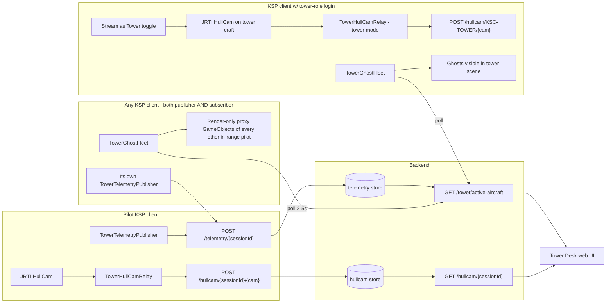

# Ghost Fleet & Tower View - Master Plan

> **World scoping:** Ghosts only render between players sharing the same `worldId` per [WORLD_AND_TIME_MODEL.md](WORLD_AND_TIME_MODEL.md) - coordinate systems, body radius, and day-length all differ across planet packs, so cross-world ghost rendering is meaningless. Cross-world players appear in an "Other Worlds" sidebar instead of as scene proxies. The tower-view hull-cam is bound to the publisher's world; a different-world subscriber sees a "Tower view from Earth-RSS KSC" banner so they know whose universe they're looking into.

**Space Centre "Park at KSC tower" (`TowerJumpToWindow`):** disabled — moving `Camera.main` and patching `SpaceCenterCamera2` by reflection fought stock every frame (black sky, wrong framing, broken camera after exit). It is **not** part of the tower web feed. Details: [DISABLED_FEATURES.md](DISABLED_FEATURES.md).

**Web tower lookout:** comes only from **Flight** + **Hullcam VDS Continued** + **JRTI** + [`TowerHullCamRelay.cs`](PluginSrc/TowerHullCamRelay.cs): JPEG snapshots from a `MuMechModuleHullCamera` on a **stationary vessel** at/near the tower, POSTed under `KSC-TOWER-*` when **Stream as Tower** is on. No dependency on Space Centre UI camera.

## Purpose

Add two cooperating features to KSCTowerNetwork that produce the *feeling* of multiplayer ATC operations without actually running synchronized physics:

1. **Ghost fleet** - lightweight, render-only stand-ins for other pilots' aircraft that appear in your KSP scene when they come into visual range, driven by the existing telemetry stream. **Symmetric and pilot-to-pilot by default**: every KSP client running the plugin is both a publisher of its own telemetry and a subscriber to everyone else's, so two pilots near each other each see the other as a ghost without any extra configuration. The tower view is just one more subscriber that happens to never move.
2. **Tower view** - a KSP client in **flight** at KSC with a **HullCam** aimed over the field (dedicated marker craft), streaming that view through the existing hull-cam relay (`KSC-TOWER-*` when streaming as tower), so web controllers see real-time silhouettes of the ghost fleet from the tower's actual perspective. The pilot's **main** camera is irrelevant; JRTI snapshots the HullCam module's render path.

The combined experience: a controller logged into the Tower Desk web UI watches a real KSP camera looking out across the runways, with ghost aircraft from other live pilots flying past it, while those same pilots see each other (and the tower's marker craft) as ghosts in their own games, while talking on the existing voice bridge.

Cross-references: this supersedes section 1 of [TELEMETRY_AND_TOWER_TRACKING_PLAN.md](TELEMETRY_AND_TOWER_TRACKING_PLAN.md), slots into Phase 1-2 of [REAL_TOWER_ROADMAP.md](REAL_TOWER_ROADMAP.md), and reuses the audio plumbing in [VOICE_IMPLEMENTATION_PLAN.md](VOICE_IMPLEMENTATION_PLAN.md).

---

## Non-goals

- Not multiplayer. No shared physics, no shared save, no docking, no part interactions.
- Not authoritative position. Ghosts can teleport, jitter, or disappear without breaking anything.
- Not a separation tool. Conflict detection lives in the web tower stack, not in-game.
- Not a replacement for the per-pilot hull cams already supported by [TowerHullCamRelay.cs](PluginSrc/TowerHullCamRelay.cs); tower view is an additional, persistent feed.

---

## Architecture

The pilot side is unchanged. The two new components (`TowerGhostFleet` plugin module and the tower-mode hull-cam path) both reuse existing endpoints, auth, and settings infrastructure.

---

## Part A - Ghost fleet (in-game traffic)

### Pilot-to-pilot is the primary case

The ghost fleet works between *any* two KSP clients, not just pilot-to-tower. Every install runs both halves of the loop:

- It already publishes its own position via [TowerTelemetryPublisher.cs](PluginSrc/TowerTelemetryPublisher.cs) (existing).
- It will subscribe to everyone else's via the new `TowerGhostFleet` module (new).

Concrete example with three concurrent pilots A, B, C all flying near KSC:

| Client | Sees as ghosts |
|--------|----------------|
| Pilot A | B and C (if in range) |
| Pilot B | A and C (if in range) |
| Pilot C | A and B (if in range) |
| Tower view | A, B, C (if in range of the tower marker craft) |

No client is special. The tower view is only distinguished by *what it does with its hull cam*, not by what it sees in-scene. This means:

- A pilot landing at KSC sees other landing aircraft directly in their cockpit view.
- Formation-flying RP works (loosely - no shared physics, but visual presence is enough for "fly past my wing" moments).
- The tower's hull cam, the pilot's cockpit, and the web Tower Desk's map all show the same set of aircraft from different vantage points - because the data source is the same `/tower/active-aircraft` snapshot.

Authorization, range filtering, settings, and pool sizing in the rest of this section apply identically to every client; nothing is tower-specific in `TowerGhostFleet` itself.

### Backend gap

There is no efficient endpoint today to fetch "all currently-active sessions with their latest telemetry." The plugin would be forced into N+1 calls of `GET /v1/session/:id`. The closest existing route is `GET /v1/admin/rooms/tower`, which is admin-only.

**New endpoint:** `GET /v1/tower/active-aircraft`

- Auth: any authenticated user (pilot or tower role); not admin-gated.
- Response: array of sanitized session snapshots `{ sessionId, callsign, craftName, craftMapIcon, bodyName, lat, lon, aslAlt, radarAlt, heading, surfaceSpeed, verticalSpeed, universalTime, updatedAt, stale }`.
- Excludes: closed sessions, sessions with `BeaconActive=false`, sessions older than `STALE_CUTOFF_SECONDS` (default 60 s), and the caller's own session.
- Pagination: capped at `MAX_ACTIVE_AIRCRAFT` (default 32) - matches roadmap scale assumption of ~3-4 active pilots.
- Lives next to the existing telemetry handlers in [backend/src/routes/api.ts](backend/src/routes/api.ts) and reads via [backend/src/services/repository.ts](backend/src/services/repository.ts).

### Plugin module: `TowerGhostFleet`

New `[KSPAddon(KSPAddon.Startup.Flight, false)]` MonoBehaviour modeled on [TowerTelemetryPublisher.cs](PluginSrc/TowerTelemetryPublisher.cs) and [TowerHullCamRelay.cs](PluginSrc/TowerHullCamRelay.cs).

**Poll loop**

- Period: starts at 3 s, accepts a server-driven `nextActiveAircraftSeconds` field on the response (clamped 1-15 s), same pattern as `nextTelemetrySeconds` in `TowerTelemetryPublisher`.
- Bails when `!FlightGlobals.ready`, no active vessel, vessel is `DEAD`, or the toggle in settings is off.
- Filters server response to: same `mainBody.bodyName` as the local active vessel, and within `GhostVisualRangeKm` (haversine distance + altitude delta capped). Default 5 km, max 25 km.
- Filters out our own `SessionId`.

**Proxy spawn**

- Pool of N=`GhostMaxConcurrent` (default 8) preallocated proxy roots.
- One root per ghost, parented under a `DontDestroyOnLoad` "GhostFleet" container.
- Mesh source: at first run, walk `PartLoader.LoadedPartsList`, pick three reference parts keyed off `craftMapIcon` already emitted by [TowerTelemetryPublisher.cs](PluginSrc/TowerTelemetryPublisher.cs):
  - `plane` -> Mk1 cockpit + Mk1 wing strake
  - `rover` -> probe core + rover wheel
  - `rocket` -> Mk1 capsule + small fuel tank
- Clone the `MeshFilter`/`MeshRenderer` chain only. No `Rigidbody`, no `Part`, no `Collider`, no PartModules, no FX. Set layer to a non-collision layer (e.g. layer 19 / `PhysicalObjects` masked off).
- Cache the cloned mesh hierarchy as a prefab on `Awake` of the singleton; reuse for every spawn.

**Per-tick update**

- For each in-range session, look up its proxy (or claim a free pool slot).
- Position: `mainBody.GetWorldSurfacePosition(lat, lon, aslAlt)`.
- Orientation: yaw from `heading`, pitch and roll skipped in v1 (set to surface-up).
- Smoothing: linear interpolate from previous sample to current using `universalTime` deltas; clamp jump to ~500 m/sample to avoid teleport pops.
- Out-of-range or stale (>`GhostStaleSeconds`, default 15 s) -> fade material alpha over 1 s, return slot to pool.
- Vessel switch (`GameEvents.onVesselChange`) -> clear all slots and rebuild on next tick.

**Settings additions** to [TowerModSettings.cs](PluginSrc/TowerModSettings.cs):

| Key | Default | Notes |
|-----|---------|-------|
| `EnableGhostFleet` | true | Master toggle, mirrored on the radio panel |
| `GhostVisualRangeKm` | 5.0 | Hard-capped at 25 |
| `GhostMaxConcurrent` | 8 | Pool size |
| `GhostStaleSeconds` | 15 | Telemetry age past which the ghost fades |
| `GhostPollSeconds` | 3.0 | Initial poll period; server overrides |

### Failure modes

- Backend offline: same long-backoff pattern used by [TowerHullCamRelay.cs](PluginSrc/TowerHullCamRelay.cs) `HandleJrtiUnreachable`.
- Mesh ripper fails (KSP version drift): fall back to a primitive `Cube` scaled to a plausible vessel size; log once.
- Ghost overlapping local craft: render-only + non-collision layer means worst case is z-fighting; acceptable for v1.

---

## Part B - Tower view (KSC look-out feed)

### Two deployment shapes (same wire protocol)

Either path produces the same thing on the wire: JPEG frames POSTed to `/v1/hullcam/{sessionId}/{cameraId}` from a KSP client in **flight** with a HullCam-equipped vessel **at KSC** (tower POV is part orientation + placement of that craft, not Space Centre `Camera.main`).

**B1. Auth-driven opt-in (primary path - new)**

Any KSP client whose logged-in account has a tower-eligible role can flip a toggle and become a tower-view source. No second machine required, though you'd typically dedicate a PC for it once it works.

- After [TowerLoginGui.cs](PluginSrc/TowerLoginGui.cs) succeeds, parse `role` out of the login response (`controller|mod|supermod|owner` -> tower-eligible; `pilot|guest` -> not).
- Add a `TowerStreamRole` field to [TowerModSettings.cs](PluginSrc/TowerModSettings.cs) populated from the response, plus an `IsTowerEligible` derived helper.
- On the existing radio panel ([TowerRadioGui.cs](PluginSrc/TowerRadioGui.cs)) add a new section, **only visible if `IsTowerEligible`**:
  - Toggle: `Stream as Tower` (default off).
  - Status line: current tower session id + cam count.
  - **No** Space Centre camera snap in MVP — the operator **loads the tower marker craft in flight** at the desired KSC coordinates and aims the HullCam part (build per `GameData/KSCTowerNetwork/PluginData/TOWER_CAM_README.txt`; optional prebuilt `.craft` later). Optional future work: a **flight-scene** "snap craft to tower coords" helper that only runs when `FlightGlobals.ready` and the vessel is safe to teleport — not the old `TowerJumpToWindow` SCC2 path.
- When the toggle is on:
  1. Override `SessionId` for outgoing hull-cam POSTs to a deterministic value `KSC-TOWER-{userId}` (so multiple controllers can each have their own tower stream during testing without collision).
  2. Suppress [TowerTelemetryPublisher.cs](PluginSrc/TowerTelemetryPublisher.cs) POSTs entirely (don't pollute the active-aircraft list with a "pilot" sitting on the tower).
  3. Force `BeaconActive = false` and grey out the beacon button.
  4. Keep voice + ghost fleet running normally - this client *should* see ghost traffic.
- Backend changes:
  - Whitelist sessionIds matching `^KSC-TOWER-[a-z0-9_-]{1,64}$` in the hull-cam upload handler in [backend/src/services/hullcamStore.ts](backend/src/services/hullcamStore.ts) so they bypass the "must belong to an open pilot session" check.
  - Add `GET /v1/tower/view-streams` returning the list of currently-publishing tower stream ids + their last frame timestamps; gated to tower roles.

**B2. Dedicated-PC mode (operational target)**

The serious deployment is a second PC running KSP 24/7, logged in as a controller, with the toggle latched on. Same code path as B1, just stable and unattended.

Setup checklist (lives in the doc, not the plugin):

1. Fresh KSP install in its own directory.
2. Install the same mod stack as a pilot: KSCTowerNetwork plugin, JRTI HullCam, Hullcam VDS Continued.
3. Log in with a `controller`-or-higher account.
4. Load your tower marker craft in **flight** (probe + Hullcam VDS camera, oriented over the runway / tower POV — see `GameData/KSCTowerNetwork/PluginData/TOWER_CAM_README.txt`).
5. Confirm the vessel is stationary at KSC and JRTI lists the camera (same checklist as any HullCam relay).
6. Flip `Stream as Tower` on.
7. Optional: launch KSP with `-popupwindow -screen-fullscreen 0` so the game can run minimized without losing the camera.

### Web changes

[TowerDesk.tsx](web/src/pages/TowerDesk.tsx) gets a new pinned panel:

- **Tower View tile**: dropdown picks from `GET /v1/tower/view-streams`, renders frames via the existing [HullCamPanel.tsx](web/src/components/HullCamPanel.tsx) component pointed at the selected `KSC-TOWER-*` session.
- Auto-selects the first available stream on load.
- Distinct visual treatment from per-pilot hull cams (e.g. labeled "TOWER LOOKOUT", placed at the top of the cam stack).

---

## The combined experience

Because every KSP client runs the same plugin (including the tower-view client), every client `TowerGhostFleet` against the same `/tower/active-aircraft` feed. That gives three independent payoffs from one mechanism:

**1. Pilot-to-pilot visual presence.** Two pilots within 5 km of each other on Kerbin each see the other's craft as a ghost in their own cockpit view. No multiplayer, no physics, but enough to fly approaches in trail, hold for traffic on final, or just wave on the apron.

**2. Tower window scene.** The tower-view client also renders the ghosts. Its hull cam captures them gliding past the runway and pushes that JPEG stream to the web. Web controllers watch real KSP footage with real-time silhouettes of real pilots.

**3. Web map convergence.** The Tower Desk map already plots each pilot from their telemetry; now the same dataset drives both the in-game ghost positions and the map markers, so what the controller sees on the map matches what they see out the tower window matches what each pilot sees in their cockpit.

End-to-end example with two pilots and a tower:

1. Pilot A (cockpit view) calls "Kerbal-12 short of 09" on voice.
2. Their telemetry hits the backend.
3. Pilot B's KSP, the tower-view KSP, and the web Tower Desk all poll `active-aircraft` on their next tick.
4. Pilot B sees A as a ghost holding short ahead of them in the conga line.
5. Tower-view client spawns A's ghost on runway 09's hold short line; its hull cam picks it up in the JPEG stream.
6. Web controller sees A both as a map marker and as a silhouette out the tower window, and clears them for takeoff over voice.

---

## Phasing

### Phase 1 - Backend foundation (small)

- Add `GET /v1/tower/active-aircraft` in [backend/src/routes/api.ts](backend/src/routes/api.ts), backed by a new repo method in [backend/src/services/repository.ts](backend/src/services/repository.ts).
- Whitelist `KSC-TOWER-*` session ids in [backend/src/services/hullcamStore.ts](backend/src/services/hullcamStore.ts).
- Add `GET /v1/tower/view-streams`.
- Exit: a curl against `/active-aircraft` with a pilot token returns the right shape and excludes the caller; a tower account can POST a JPEG to `/hullcam/KSC-TOWER-foo/0` and `GET /tower/view-streams` lists it.

### Phase 2 - Ghost fleet plugin

- New `TowerGhostFleet.cs` MonoBehaviour, plane template only, Kerbin only, 5 km range.
- Settings additions in [TowerModSettings.cs](PluginSrc/TowerModSettings.cs).
- Manual two-instance test (two KSP installs side-by-side, separate accounts).
- Exit: from inside one client, you can see the other client's craft as a moving silhouette within 5 km.

### Phase 3 - Tower view stream toggle (B1)

- Login response role parsing in [TowerLoginGui.cs](PluginSrc/TowerLoginGui.cs).
- "Stream as Tower" section on [TowerRadioGui.cs](PluginSrc/TowerRadioGui.cs), gated on `IsTowerEligible`.
- Hull-cam POST routing override when toggle is on.
- Telemetry / beacon suppression when toggle is on.
- `GameData/KSCTowerNetwork/PluginData/TOWER_CAM_README.txt` for flight-scene tower placement + optional future bundled `.craft` (SC camera park **out of scope**; see [DISABLED_FEATURES.md](DISABLED_FEATURES.md)).
- Web: new Tower View tile on [TowerDesk.tsx](web/src/pages/TowerDesk.tsx) wired to `/tower/view-streams` + [HullCamPanel.tsx](web/src/components/HullCamPanel.tsx).
- Exit: log in with a controller account, flip the toggle, and see the tower POV appear on the web Tower Desk.

### Phase 4 - Polish

- Rover and rocket ghost templates.
- Pitch/roll on ghosts.
- Nameplate billboard above each ghost (callsign + altitude), opt-in.
- Spline interpolation between samples instead of linear.
- Optional: tower-side wide-angle cam preset and a runway-centerline cam preset on the marker craft.

### Phase 5 - Dedicated tower PC (B2)

- Operational doc in [HOSTING.md](HOSTING.md) covering the unattended-second-PC setup.
- systemd-equivalent / Windows scheduled task to relaunch KSP if it crashes.
- Health check: `/tower/view-streams` showing a fresh frame timestamp every <5 s.

---

## Risks & mitigations

| Risk | Mitigation |
|------|------------|
| Mesh-ripping from `PartLoader` breaks across KSP patches | Cache on first load; fall back to `PrimitiveType.Cube` scaled appropriately; log once and continue. |
| Ghost teleport when telemetry samples skip | Linear interpolate by `universalTime`; clamp per-tick movement to a sane envelope; fade out and re-fade in on >`GhostStaleSeconds`. |
| Tower-view client accidentally publishes telemetry as a "pilot" sitting on the tower | Force-suppress in `TowerTelemetryPublisher` when `Stream as Tower` is on; force `BeaconActive=false`; backend additionally rejects telemetry posts whose sessionId matches `KSC-TOWER-*`. |
| Multiple controllers all toggle on at once and produce duplicate tower streams | Allow it. `view-streams` lists them all; UI lets the operator pick. Document a "primary tower" convention. |
| KSP audio bug freezes the unattended tower PC | Existing voice bridge anti-freeze work in [VOICE_IMPLEMENTATION_PLAN.md](VOICE_IMPLEMENTATION_PLAN.md) applies; tower PC should also disable its own mic capture in settings. |
| `KSC-TOWER-*` sessionId namespace collisions with future features | Reserve the prefix in the backend, document it, validate format on every hullcam POST. |
| Ghost fleet adds frame-rate cost on weak machines | `GhostMaxConcurrent` cap + render-only meshes keep it cheap; expose `EnableGhostFleet=false` for opt-out. |
| Space Centre camera hijack for "tower view" | **Do not** use for web feed; breaks `SpaceCenterCamera2` / atmosphere. Tower web video = **Flight** + HullCam + JRTI only. |

---

## Test plan

**Single-machine dev**

- Two KSP installs in separate directories pointing at the same backend.
- Account A flies a plane near KSC; account B flies another plane within 5 km.
- Verify each sees the other's ghost; verify ghosts despawn at >15 s stale or >5 km separation.

**Tower toggle**

- Log in as a `pilot` -> "Stream as Tower" section is hidden.
- Log in as a `controller` -> section visible; toggle off-by-default.
- Toggle on -> verify telemetry POSTs stop, beacon button greys out, hullcam POSTs go to `KSC-TOWER-*`, web tile shows frames within 2 s.
- Toggle off -> normal pilot behavior resumes within one telemetry tick.

**Backend integrity**

- Pilot account cannot POST to `/hullcam/KSC-TOWER-anything/*` (rejected: not tower-eligible).
- Telemetry POST to a `KSC-TOWER-*` sessionId is rejected.
- `/active-aircraft` excludes closed sessions, the caller's own session, and beacon-off sessions.

**Failure modes**

- Backend down: ghost fleet pauses cleanly; UI shows a quiet status line, no exception spam.
- JRTI not installed on tower PC: same long-backoff path as today; toggle still flips but cam count stays at 0 with a hint to install JRTI.
- Two controllers toggle on with the same userId (impossible by design but tested defensively): backend treats latest stream as authoritative for that session id.

---

## Files touched (forward-looking inventory)

Plugin (new): `PluginSrc/TowerGhostFleet.cs`, `GameData/KSCTowerNetwork/PluginData/TOWER_CAM_README.txt` (tower marker how-to; optional `.craft` later).

Plugin (edits): [TowerModSettings.cs](PluginSrc/TowerModSettings.cs) (new keys + role field), [TowerLoginGui.cs](PluginSrc/TowerLoginGui.cs) (parse role from response), [TowerRadioGui.cs](PluginSrc/TowerRadioGui.cs) (Stream-as-Tower section), [TowerHullCamRelay.cs](PluginSrc/TowerHullCamRelay.cs) (sessionId override when in tower mode), [TowerTelemetryPublisher.cs](PluginSrc/TowerTelemetryPublisher.cs) (suppress when in tower mode).

Plugin (legacy / not in MVP): [TowerJumpToWindow.cs](PluginSrc/TowerJumpToWindow.cs) — Space Centre camera park; **disabled** ([DISABLED_FEATURES.md](DISABLED_FEATURES.md)). Do not wire tower web video through it.

Backend (edits): [backend/src/routes/api.ts](backend/src/routes/api.ts) (two new GETs), [backend/src/services/repository.ts](backend/src/services/repository.ts) (active-aircraft query), [backend/src/services/hullcamStore.ts](backend/src/services/hullcamStore.ts) (KSC-TOWER prefix handling).

Web (edits): [web/src/pages/TowerDesk.tsx](web/src/pages/TowerDesk.tsx) (Tower View tile), reuses [web/src/components/HullCamPanel.tsx](web/src/components/HullCamPanel.tsx) unchanged.

Docs (edits): [TELEMETRY_AND_TOWER_TRACKING_PLAN.md](TELEMETRY_AND_TOWER_TRACKING_PLAN.md) (mark section 1 as superseded by this doc), [REAL_TOWER_ROADMAP.md](REAL_TOWER_ROADMAP.md) (link from Phase 1/2), [HOSTING.md](HOSTING.md) (Phase 5 dedicated-PC checklist).
