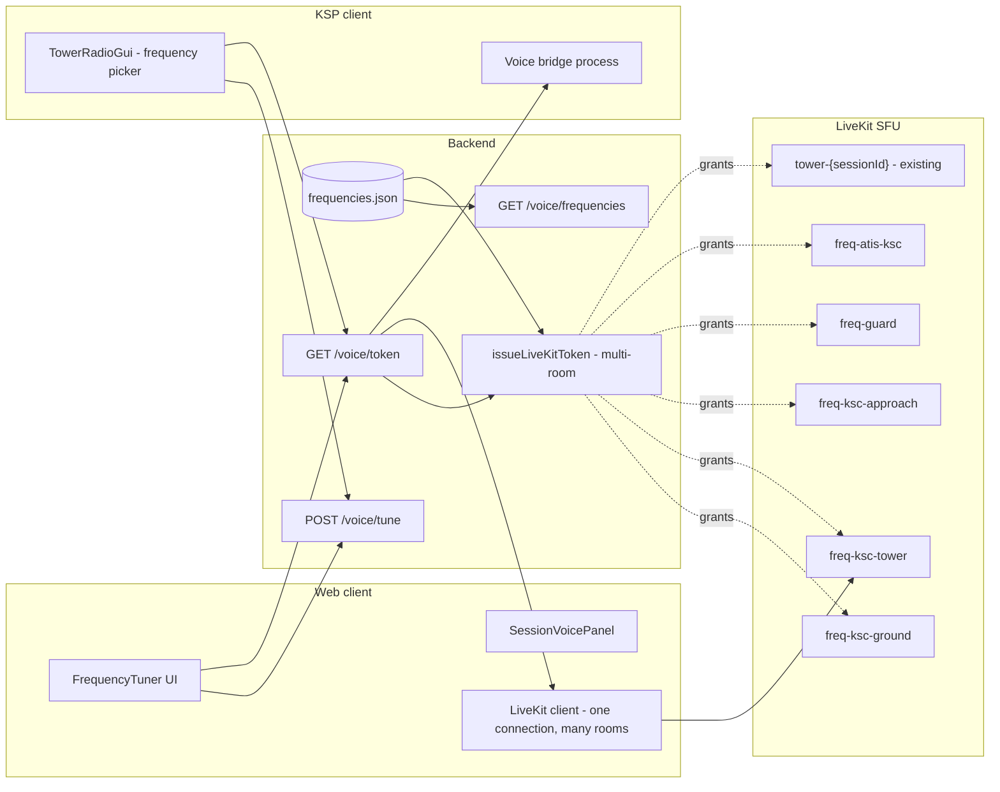

# Per-Frequency Channels - Plan

> **World scoping:** Per-airport ATC frequencies (Ground / Tower / Approach / CTAF / ATIS) are `(worldId, airportId)`-scoped per [WORLD_AND_TIME_MODEL.md](WORLD_AND_TIME_MODEL.md). `frequencies.json` is per-world; frequency ids are disambiguated server-side as `{worldId}/{slug}` even when the UI label abbreviates to "KSC TWR". RSS-KSC Tower and stock-KSC Tower are distinct LiveKit rooms. Cross-world general/Guard frequencies remain world-agnostic.

## Purpose

Replace the single per-session voice room with a set of persistent ATC frequencies (Ground / Tower / Approach / CTAF / Guard) that users tune to and monitor independently. A user has *one* primary frequency they transmit on at any time, plus zero or more monitor-only frequencies they hear in the background.

Lifted from [ROLEPLAY_FEATURES_CATALOG.md](ROLEPLAY_FEATURES_CATALOG.md) section 1.3 into its own plan because it touches the LiveKit token model, every voice surface in web + plugin, and is a hard prerequisite for handoff ([REAL_TOWER_ROADMAP.md](REAL_TOWER_ROADMAP.md) section 6), the multi-role seats (catalog section 4), the ATIS frequency move ([ATIS_PLAN.md](ATIS_PLAN.md) Phase 5), and CapCom (catalog 4.6).

---

## Design intent

Real ATC works because each frequency is its own conversation. A pilot calls Ground for taxi, switches to Tower at the hold short, then Departure once airborne. A controller working Tower can have Ground in their other ear at low volume to coordinate. The current single-room model collapses all of that into one Discord-style channel.

We want:

- **Persistent frequencies**, not per-session rooms. Frequencies survive across sessions; sessions just *use* them.
- **One primary, many monitors.** Talk on one, listen to many. Standard ATC ear-piece model.
- **Cheap switching.** Tuning to a different frequency should feel like turning a knob, not reconnecting to a server.
- **Backwards-compatible.** Existing `tower-${sessionId}` per-session rooms keep working as private "session sidebars" (mission CapCom in catalog 4.6), they just are no longer the only place voice happens.

Cross-references: [ATIS_PLAN.md](ATIS_PLAN.md) (Phase 5 of ATIS depends on this); [REAL_TOWER_ROADMAP.md](REAL_TOWER_ROADMAP.md) sections 6 + 9; [VOICE_IMPLEMENTATION_PLAN.md](VOICE_IMPLEMENTATION_PLAN.md); [GHOSTS_AND_TOWER_VIEW_PLAN.md](GHOSTS_AND_TOWER_VIEW_PLAN.md) (orthogonal but ships in parallel); [ROLEPLAY_FEATURES_CATALOG.md](ROLEPLAY_FEATURES_CATALOG.md) (entry).

---

## Non-goals

- Not real radio physics. No range falloff, no propagation delay, no stuck-frequency simulation.
- Not multi-airport. KSC frequencies only in v1.
- Not user-creatable frequencies. The set is configured server-side (admin can add to a config file; users cannot conjure new freqs).
- Not per-frequency PTT keys. One PTT, transmits on whatever primary is currently tuned.

---

## Frequency model

### Default frequency set (KSC, v1)

Configured in a new backend file `backend/data/frequencies.json` or env-bound via `FREQUENCIES_JSON`. Each entry carries **two human-facing names** plus the canonical id:

- `id` — internal canonical slug, world-scoped (e.g. `stock/ksc-tower`). Never shown to users; what every other backend resource keys on.
- `shortName` — short English handle a human would say in chat (e.g. `stock2`, `RSS-twr`, `guard`). Case-insensitive, unique within a world. This is what shows up in compact UI chips and what a controller would type in a casual chat shorthand like "go stock2".
- `navCode` — the numeric tune code a pilot enters into the in-game nav computer / radio panel, and the token a controller broadcasts in the text channel to retune them (see section 6 for the chat-number-as-tune wiring). Globally unique across worlds *and* across the per-world frequency tables — the in-game radio is a dumb numeric keypad and must not require world disambiguation.
- `display` — long descriptive label (e.g. "Stock KSC Tower"). Shown in tooltips, full panels, audit logs.
- `mhz` — cosmetic notional MHz string (e.g. `118.5`). Pure flavor; no logic keys on it. Optional.

v1 ships with (one stock world + one RSS world shown to illustrate the cross-world numeric uniqueness; the catalog grows per world):

| ID | shortName | navCode | Display | MHz | Purpose | Default role access |
|----|-----------|---------|---------|-----|---------|---------------------|
| `stock/ksc-ground`   | `stock1`   | `217` | Stock KSC Ground   | 121.7  | Taxi / pushback / ramp | controller_ground+, all pilots |
| `stock/ksc-tower`    | `stock2`   | `185` | Stock KSC Tower    | 118.5  | Active runway / pattern | controller+, all pilots |
| `stock/ksc-approach` | `stock3`   | `191` | Stock KSC Approach | 119.1  | Inbound / vectoring | controller+, all pilots |
| `stock/ksc-ctaf`     | `stock-c`  | `228` | Stock KSC CTAF     | 122.8  | Self-announce when no controller online | all (pilots can talk uncontrolled) |
| `stock/atis-ksc`     | `stock-a`  | `196` | Stock ATIS KKSC    | 119.65 | Continuous ATIS broadcast | listen only for everyone except the ATIS bot |
| `rss/ksc-ground`     | `RSS1`     | `317` | RSS KSC Ground     | 121.9  | Taxi / pushback / ramp | controller_ground+, all pilots |
| `rss/ksc-tower`      | `RSS2`     | `267` | RSS KSC Tower      | 126.7  | Active runway / pattern | controller+, all pilots |
| `rss/ksc-approach`   | `RSS3`     | `285` | RSS KSC Approach   | 128.55 | Inbound / vectoring | controller+, all pilots |
| `rss/ksc-ctaf`       | `RSS-c`    | `328` | RSS KSC CTAF       | 132.8  | Self-announce when no controller online | all |
| `rss/atis-ksc`       | `RSS-a`    | `292` | RSS ATIS KKSC      | 129.2  | Continuous ATIS broadcast | listen only |
| *(world-agnostic)* `guard` | `guard` | `121` | Guard | 121.5 | Emergency / crosstalk | all (talk + monitor by default) |

Schema (one entry):

```json
{
  "id": "stock/ksc-tower",
  "worldId": "stock",
  "airportId": "ksc",
  "shortName": "stock2",
  "navCode": "185",
  "display": "Stock KSC Tower",
  "mhz": "118.5",
  "purpose": "Active runway / pattern",
  "talkRoles": ["pilot", "controller", "mod", "supermod", "owner"],
  "monitorRoles": ["pilot", "controller", "mod", "supermod", "owner", "guest"],
  "atisLoop": false
}
```

Validation rules enforced at config load time in `frequencies.ts`:

- `id` matches `^[a-z0-9-]+(/[a-z0-9-]+)?$`. The world-agnostic frequencies (`guard`) have no slash; world-scoped ones must be `{worldId}/{slug}`.
- `shortName` matches `^[A-Za-z][A-Za-z0-9-]{0,7}$` (1–8 chars, ASCII, leading letter). Case-insensitive uniqueness checked **per world** (including world-agnostic entries treated as a virtual `*` world).
- `navCode` matches `^[0-9]{3,4}$` (3- or 4-digit numeric). **Global uniqueness across the entire frequencies.json** — `stock2` and `RSS2` cannot share a code. Codes `7700`, `7600`, `7500`, `1200` are reserved (squawk codes from [IDENTITY_PLAN.md](IDENTITY_PLAN.md), see 2.3) and rejected at load.
- Bad config aborts boot with a loud error listing every collision; the fallback minimal `[ksc-tower, guard]` set still satisfies these rules.

Two free helpers on the loaded registry:

- `lookupByNavCode(code: string): Frequency | null` — primary entry point for the chat-number tune path (section 6) and the in-game radio keypad.
- `lookupByShortName(world: string, name: string): Frequency | null` — for chat shorthand and admin tooling. Falls back to world-agnostic if no per-world match.

### Persistent vs ephemeral rooms

Two kinds of LiveKit rooms coexist after this change:

- **Frequency rooms** (new, persistent): one per entry in the frequency table, named `freq-{id}` (e.g. `freq-ksc-tower`). Created lazily on first listener. Live indefinitely.
- **Session rooms** (existing, ephemeral): `tower-${sessionId}`, one per session, used as private mission sidebars / CapCom (catalog 4.6). Unchanged.

A user is typically in 1-3 frequency rooms (one primary + 1-2 monitors) and at most one session room.

### Talk vs monitor semantics

LiveKit doesn't model "monitor only" directly, but it does model `canPublish` per room.

- **Primary**: token grant has `canPublish: true, canSubscribe: true` for that room.
- **Monitor**: token grant has `canPublish: false, canSubscribe: true` for that room.
- **Off**: not granted, client doesn't join that room.

A user can have at most one primary at any time. Switching primary requires re-issuing the token (cheap).

---

## Architecture



---

## Components

### 1. Frequency config + registry (backend, new)

- `backend/data/frequencies.json` - declarative list with the schema:

```json
[
  {
    "id": "ksc-tower",
    "display": "KSC Tower",
    "mhz": "118.5",
    "purpose": "Active runway / pattern",
    "talkRoles": ["pilot", "controller", "mod", "supermod", "owner"],
    "monitorRoles": ["pilot", "controller", "mod", "supermod", "owner", "guest"],
    "atisLoop": false
  }
]
```

- New service `backend/src/services/frequencies.ts` - loads, validates against the role enum from [webAuth.ts](backend/src/services/webAuth.ts), exposes `listFrequencies()`, `canTalk(userRole, freqId)`, `canMonitor(userRole, freqId)`, `roomNameFor(freqId)`.
- Hot-reloadable on SIGHUP for ops.

### 2. Token issuance (backend, edited)

Generalize [issueLiveKitToken in livekit.ts](backend/src/services/livekit.ts) to accept multiple rooms in a single call:

```ts
issueLiveKitToken({
  userId,
  displayName,
  rooms: [
    { name: "freq-ksc-tower",   canPublish: true,  canSubscribe: true },
    { name: "freq-ksc-ground",  canPublish: false, canSubscribe: true },
    { name: "freq-atis-ksc",    canPublish: false, canSubscribe: true },
    { name: "tower-abc123",     canPublish: true,  canSubscribe: true }
  ]
})
```

LiveKit's `AccessToken.addGrant` already supports multiple grants on a single JWT - the SDK isn't currently used that way but supports it.

### 3. Tuning state (backend, new)

In-memory state per `userId`:

```ts
{
  userId,
  primaryFreqId: "ksc-tower" | null,   // null = transmit-disabled
  monitorFreqIds: ["ksc-ground", "atis-ksc"],
  sessionRoomId: "tower-abc123" | null  // current ephemeral session room
}
```

- Lives in Redis (already used per [backend/src/lib/redis.ts](backend/src/lib/redis.ts)) with a 24 h TTL.
- Survives token refresh; only nuked on explicit logout.
- Defaults on first login: primary = first frequency the user can talk on (probably `ksc-tower` for controllers, `ksc-ctaf` for solo pilots), monitors = `[guard, atis-ksc]`.

### 4. New API surface

| Method | Path | Auth | Purpose |
|--------|------|------|---------|
| `GET` | `/v1/voice/frequencies` | any authed | Returns the configured frequency list filtered to what the caller may tune to / monitor. |
| `GET` | `/v1/voice/tuning` | any authed | Returns this user's current tuning state. |
| `POST` | `/v1/voice/tune` | any authed | Body: `{ primaryFreqId?, monitorFreqIds?, sessionRoomId? }`. Validates against role table. Updates state, returns new tuning + a fresh LiveKit token covering the new room set. |
| `GET` | `/v1/voice/token` | any authed | Issues a token for the user's *current* tuning state. Used on reconnect. |

(See section 6 below for the controller- and mod-initiated `POST /v1/voice/tune/:targetUserId` variant that lets tower staff move *other* users between rooms.)

All in [backend/src/routes/api.ts](backend/src/routes/api.ts). The existing per-session token endpoint at line ~1123 stays for backwards-compat but starts returning a token whose room set also includes the user's current frequency monitors, not just the session room.

### 5. Hot-switching primary

When a user re-tunes their primary:

1. Backend updates Redis state.
2. Backend re-issues the LiveKit token with the new grants and returns it.
3. Client calls `room.disconnect()` for any frequency it's no longer in, then `room.connect()` for any newly-tuned room with the new token.
4. Existing rooms the user is staying in: client calls `room.localParticipant.setTrackPublishPermission` based on the new grants - no full reconnect needed.

This is sub-second on a working connection. Documented "tune knob" feel.

If LiveKit's client-side permission update API is finicky, fallback path: full reconnect of just the affected room (~1-2 s). Acceptable.

### 6. Controller- and mod-initiated tuning (move other users between frequencies)

The `/voice/tune` endpoints in section 4 only mutate the *caller's* tuning state. Real ATC, and real moderation, need the inverse: a controller telling a pilot "contact Tower 118.5", and a mod yanking a disruptive user off Guard. Both are "re-tune user X onto frequency Y" operations, with different consent semantics.

> **Scope (read this first if you came in cold).** The word "room" is overloaded in this codebase — see [docs/GLOSSARY.md](docs/GLOSSARY.md) "Room" for the three meanings. This section concerns **frequency voice rooms only** (`freq-*`) and optionally session voice sidebars (`tower-{sessionId}`). It does **not** touch the *tower session* itself: a moved user keeps their session, their telemetry stream, their hull-cam, their flight strip, their chat thread, and their squawk. Only their LiveKit primary frequency room changes. The Tower tab and everything on it is powered by the session HTTP polling path (`GET /v1/session/:id`), not by LiveKit room membership, so a forced re-tune is invisible to every non-voice surface.

#### Two modes

**Suggested tune (controller-initiated, pilot-acknowledged)**
- Real-radio analogue: "Bobcat 7, contact KSC Ground 121.7."
- Issued by a `controller` who currently owns the target's strip (per [REAL_TOWER_ROADMAP.md](REAL_TOWER_ROADMAP.md) section 6 ownership), or by a `controller` tuned as primary on the target's *current* primary frequency (i.e. they're talking to them now).
- Target sees a banner / chip with a one-click **Tune** button. If they ignore it for `autoApplySeconds` (default 8 s, configurable per-airport, never <3 s), the tune is auto-applied. Banner stays visible for another 5 s post-apply so the pilot knows what happened.
- Target may also click **Decline**, which posts a "unable" event back to the controller's strip; controller can then re-issue or escalate.
- Cannot move a target to a frequency they don't have `canMonitor` for via their role. `canTalk` is *not* required — this is the standard "switch you to Approach as listen-only" pattern.

**Forced tune (mod-initiated, no consent)**
- Issued by `mod`, `supermod`, or `owner`.
- Applies immediately. Target sees a non-dismissable banner: `"Moved to {freq} by {actor}: {reason}"`. No countdown, no opt-out from the client side.
- Mods may force a target *off* `canTalk` (i.e. drop them from primary into monitor-only on the same room, or pull them out of a freq entirely) for griefer handling.
- Mods may **not** force a target onto a freq the target's role can't even monitor. Use the existing role escalation flow for that, not a tune push.
- Forced tune of an equal-or-higher role is rejected (mod cannot force-tune another mod; supermod can force-tune mods; owner can force-tune anyone).

Both modes can also push a `sessionRoomId` change — useful for "pull this pilot into the CapCom sidebar" (catalog 4.6) or "isolate this user in a 1:1 review room with a mod."

#### API

| Method | Path | Auth | Purpose |
|--------|------|------|---------|
| `POST` | `/v1/voice/tune/:targetUserId` | controller (suggest) or mod+ (force) | Body: `{ mode: "suggest" \| "force", primaryFreqId? \| primaryNavCode?, monitorFreqIds? \| monitorNavCodes?, sessionRoomId?, reason?: string, autoApplySeconds?: number }`. Either id or navCode form is accepted; mixing is allowed; the server resolves navCodes via `lookupByNavCode` before validating roles. |
| `POST` | `/v1/voice/tune/:targetUserId/ack` | the target user only | Body: `{ acceptedTuneId: string, action: "accept" \| "decline" }`. Closes out a suggested tune. |
| `GET`  | `/v1/voice/tune/pending` | any authed | Returns suggested tunes addressed to the caller that are still within their auto-apply window. |

Same file as the existing voice routes ([backend/src/routes/api.ts](backend/src/routes/api.ts)). The mutation goes through the same Redis-backed `voiceTuning.ts` helper added in section 3, so all three paths (self-tune, suggested-then-accepted, forced) end up in one canonical state update + token reissue path.

#### Push to the target client

A tune push (suggested or forced) needs to reach the target's web *and* plugin clients in <1 s, regardless of which one is foreground. Two transport options, picked by which the target client already has open:

1. **LiveKit data message** on a room both actor and target are guaranteed to share. `freq-guard` is the natural carrier — every role has it as a default monitor. Payload is a small JSON envelope `{ type: "voice.tune.push", tuneId, mode, targets, deadlineMs, reason, actor }` addressed to a specific `targetUserId`.
2. **SSE on the existing `/v1/events` stream** as a fallback for clients that aren't currently in any LiveKit room (e.g. plugin with voice bridge offline). Same envelope shape.

The web client wires this into a new `useTunePush()` hook that drops into `FrequencyTuner` (section "Web UI") to render the banner. The plugin wires it into [TowerRadioGui.cs](PluginSrc/TowerRadioGui.cs)'s frequency section and reuses the existing TUNE bridge protocol message (section "KSP plugin") to actually do the reconnect.

#### Chat-number-as-tune (the "just type the number" path)

The dual-name model from "Frequency model" above means every room has a 3- or 4-digit `navCode`. That code is the lingua franca between the controller's chat box, the in-game radio keypad, and the tune-push API. The wiring is intentionally trivial:

1. **Controller types a bare number in chat.** A new chat parser in [backend/src/services/chat.ts](backend/src/services/chat.ts) (or wherever the room-chat ingest lives) inspects every outgoing message from a `controller`+ user. If the trimmed body is exactly `^[0-9]{3,4}$` *and* matches a known `navCode`, it is intercepted: the message is **not** broadcast as plain chat, and instead a suggested tune-push is issued to every pilot the controller is currently talking to (target set = pilots whose strip the controller owns, or pilots tuned to the controller's current primary). The chat row is replaced with a structured `tune-push` event row showing `"→ stock2 (185)"` so the rest of the room can see what was sent.
2. **Controller types `force <code>` or `move <user> <code>`.** Same parser, but routes through the force or per-target variant. `move <shortName> <code>` is also accepted (e.g. `move bobcat-7 185`) for unambiguous targeting; `<shortName>` is resolved against the callsign registry from [IDENTITY_PLAN.md](IDENTITY_PLAN.md).
3. **Pilot receives the push** through the existing LiveKit-data / SSE banner (see "Push to the target client" above). The banner shows both names: `"Contact stock2 (nav 185)"` so the pilot can verify before tapping **Tune**, or punch `185` into their nav computer keypad if they prefer the in-game flow.
4. **Pilot types a number into the in-game nav keypad.** [TowerRadioGui.cs](PluginSrc/TowerRadioGui.cs) already gets a frequency section in section "KSP plugin"; the keypad input there resolves the code via the same `lookupByNavCode` helper exposed on `GET /v1/voice/frequencies`, then runs the standard self-tune flow against `POST /v1/voice/tune`. No special server path needed.

This is why `navCode` must be globally unique across worlds (validation rule above): the in-game keypad has no concept of "which world am I in", and a controller's chat box can't be expected to disambiguate either. One number, one room, anywhere in the system.

Edge cases the parser handles:

- Code is valid but the typing controller has no authority over any pilot the code targets → the row is left as plain chat with a small grey hint "no eligible targets — type `move <callsign> <code>` to be explicit." No 4xx surfaced to the user; this is a chat affordance, not a hard API call.
- Code is valid but resolves to a freq the candidate target can't `canMonitor` → that target is silently skipped, surfaced in an ops-timeline event for the controller's later review.
- Code is invalid (no match) → message is broadcast as plain chat unchanged. Numbers like `"118.5"` or `"7700"` (which is a reserved squawk, never a navCode) are passed through normally so pilots can still chat about MHz and squawks without triggering tunes.
- Rate limit on the chat-derived suggested-tunes is the same as the API limit (30/min per actor).

#### Tower UX

On the per-strip control row in [TowerDesk.tsx](web/src/pages/TowerDesk.tsx) (the strips work in [REAL_TOWER_ROADMAP.md](REAL_TOWER_ROADMAP.md) section 3 already adds this row), add a **Hand off →** dropdown listing every freq the controller is allowed to push the pilot onto (filtered by target's `canMonitor`). One click = suggested tune.

On the per-participant context menu in `FrequencyTuner`, controllers see **Suggest tune…** and mods additionally see **Force tune…** (red) and **Pull into session sidebar**. Both open a tiny modal: target freq, optional reason, confirm.

#### Plugin UX

The pilot kneeboard / radio panel ([TowerRadioGui.cs](PluginSrc/TowerRadioGui.cs)) gets a banner row at the top:

```
┌─ Frequency change requested ─────────────────────────────┐
│ Controller A: contact KSC Ground 121.7   [Tune] [Decline]│
│ Auto-tuning in 6 s…                                      │
└──────────────────────────────────────────────────────────┘
```

For a forced tune the buttons are gone and the banner is red:

```
┌─ Moved by mod ───────────────────────────────────────────┐
│ Mod Bob moved you to guard (nav 121).                    │
│ Reason: stop transmitting on Tower frequency             │
└──────────────────────────────────────────────────────────┘
```

The frequency section on [TowerRadioGui.cs](PluginSrc/TowerRadioGui.cs) (added in section "KSP plugin" below) also gets a small **nav keypad** input — three or four digits + Enter — that resolves through `lookupByNavCode` and runs the standard self-tune. Both the dropdown chip and the keypad show the same dual-name format `stock2 · 185 · KSC Tower` so the pilot's mental model stays single regardless of which surface they used to tune.

#### Safety + audit

- Rate-limited per actor: 10 force-tunes / minute and 30 suggested-tunes / minute, both per `userId`. Rejected with `429`.
- Every push (suggest, accept, decline, expire, force) writes one entry to the operational timeline ([REAL_TOWER_ROADMAP.md](REAL_TOWER_ROADMAP.md) section 7) with: actor, target, mode, before/after tuning, reason, outcome.
- Forced tunes additionally surface on the AdminDesk audit feed and increment a per-mod counter for abuse review.
- A target whose forced-tune count from a single non-owner mod exceeds 5 in 10 minutes flags a supermod alert. Cheap, easy to tune, prevents mods using force-tune as harassment.
- Self-tune via the existing endpoints is *not* affected — pilots can always re-tune themselves back, including immediately after a forced move. Mods enforce, they don't pin. Pinning a target to a frequency is a separate, higher-permission action (deferred — out of scope for v1).

#### Phasing fit

- Phase 1 ships the backend endpoints + audit hook only (admin can curl-force a tune; no UI).
- Phase 2 adds the web banner + Hand-off dropdown.
- Phase 3 adds the plugin banner + bridge wiring.
- Plugs into the existing Phase 5 (Tower handoff): a "transfer to next sector" button is just a controller-initiated suggested tune issued as part of the handoff brief.

### 7. ATIS bot tuning

The ATIS injector from [ATIS_PLAN.md](ATIS_PLAN.md) currently joins the per-session room. After this lands, it joins **only `freq-atis-ksc`** instead. Pilots/controllers tune `atis-ksc` as a monitor frequency to hear it. This is Phase 5 of the ATIS plan, unblocked by this work.

---

## Web UI

### `FrequencyTuner` (new)

Compact strip component, fits at the top of [SessionVoicePanel.tsx](web/src/session/SessionVoicePanel.tsx):

```
┌─ Voice ──────────────────────────────────────────────────┐
│ Primary: [KSC Tower ▾]  PTT: SPACE   ◉ Mic: -12 dB       │
│ Monitor: [✓] Ground  [✓] Guard  [✓] ATIS  [ ] Approach   │
│                                                          │
│ ─ Currently in room ─                                    │
│  Speaking: Bobcat 7 (ksc-tower)                          │
│  Idle:     Jeb (ksc-ground), Val (atis bot)              │
└──────────────────────────────────────────────────────────┘
```

- Primary is a dropdown of all frequencies this user `canTalk` on.
- Monitor checkboxes for everything the user `canMonitor` (greyed for those they can't).
- "Idle / speaking" list groups participants by frequency, not just one big list.
- Each speaker line shows which freq they're transmitting on, in a small chip.

### Tower Desk integration

[TowerDesk.tsx](web/src/pages/TowerDesk.tsx) gets a top-bar variant of the tuner that's always visible (controllers want to see frequency state at a glance, not buried in the voice panel).

---

## KSP plugin

[TowerRadioGui.cs](PluginSrc/TowerRadioGui.cs) gets a frequency section:

- Dropdown for primary frequency.
- Checkboxes for monitors.
- Calls the new `/voice/tune` endpoint and updates the local voice bridge subscription.

[TowerModSettings.cs](PluginSrc/TowerModSettings.cs) caches `LastPrimaryFreqId` and `LastMonitorFreqIds` so the radio comes up tuned the same way after a restart.

The voice bridge process ([KSCTowerNetwork-voice-bridge/voice-bridge/src/bridge.ts](../KSCTowerNetwork-voice-bridge/voice-bridge/src/bridge.ts)) gets a small protocol extension on the local TCP socket: a new `TUNE` message from the plugin tells the bridge which rooms to join with which permissions. The bridge then re-runs its LiveKit connect with the new token.

---

## Phasing

### Phase 1 - Backend foundation

- `frequencies.json` config + `frequencies.ts` service.
- `GET /voice/frequencies` returns the role-filtered list.
- Redis-backed tuning state.
- `issueLiveKitToken` accepts multi-room grants.
- `GET /voice/tuning`, `POST /voice/tune`, `GET /voice/token` shipped.

Exit: curl flow works end-to-end, tokens contain the right grants for the right rooms, role gating verified.

### Phase 2 - Web tuner

- `FrequencyTuner` component.
- Wire into [SessionVoicePanel.tsx](web/src/session/SessionVoicePanel.tsx).
- LiveKit client connects to multiple rooms based on tuning state.
- Per-room mute/unmute + per-participant volume preserved across re-tunes.

Exit: a controller can tune Tower as primary, monitor Ground + Guard, and switch primary to Ground in <2 s without losing call history.

### Phase 3 - Plugin tuner + bridge protocol

- Frequency section on [TowerRadioGui.cs](PluginSrc/TowerRadioGui.cs).
- `TUNE` message in the voice bridge protocol.
- Bridge reconnects on tune.

Exit: a pilot in KSP can switch primary frequency from the in-game radio panel and the call lands on the right room within 2 s.

### Phase 4 - ATIS frequency move

- ATIS bot moves from per-session rooms to `freq-atis-ksc` only.
- Per-user ATIS mute/volume from [ATIS_PLAN.md](ATIS_PLAN.md) Phase 3 retired in favour of "untune ATIS to mute it."
- ATIS card on Tower Desk surfaces "you are not currently monitoring ATIS - tune it?" if the controller hasn't.

Exit: ATIS no longer audible on Tower freq unless explicitly tuned. ATIS plan Phase 5 marked complete.

### Phase 5 - Tower handoff

- Implements [REAL_TOWER_ROADMAP.md](REAL_TOWER_ROADMAP.md) section 6 handoff workflow on top of the tune API: "transferring control" = controller A re-tunes off Tower as primary, controller B re-tunes onto it.
- Handoff briefing endpoint (catalog 3.6) writes a brief at the moment of re-tune.

Exit: shift change between two controllers is a single button press that re-tunes both.

### Phase 6 - Multi-role seats

- Catalog section 4 seats (Ground, Approach, CapCom, Range Safety) each get default tuning presets.
- Admin Desk shows current tuning across all online controllers.

Exit: a controller can pick "Take Ground seat" and have their tuner pre-configured (primary = Ground, monitors = Tower + Guard + ATIS).

---

## Risks and mitigations

| Risk | Mitigation |
|------|------------|
| LiveKit multi-room subscribe behaviour changes between SDK versions | Pin the SDK version, smoke-test on every bump, document the assumption explicitly. |
| 50-participant cap on rooms ([livekit.ts](backend/src/services/livekit.ts) `maxParticipants: 50`) becomes the *per-frequency* cap | Bump to 100 for the persistent freq rooms, keep 50 for session rooms. Document the budget. |
| Bandwidth blowup from monitoring many rooms | Subscribed-but-silent rooms cost almost nothing on Opus; document and measure on first real load. |
| Controller forgets to tune Tower as primary and silently can't transmit | UI shows a yellow banner "you are listening to Tower but transmitting on Ground" any time monitors include the room a recent transmission was attempted on. |
| Pilot tunes off ATIS and misses an emergency NOTAM | Critical NOTAMs (catalog 6.5) override and play on Guard regardless. |
| Existing per-session voice flow breaks during migration | Phase 1 keeps the per-session room in the token grant. UI doesn't change until Phase 2. Existing flows are not removed; they coexist. |
| Plugin and web get out of sync about which freq the user is on | Tuning state is server-authoritative; both clients render from `GET /voice/tuning`, never local cache as truth. |
| Frequency config malformed -> backend won't boot | Validate on load, fall back to a hardcoded minimal `[ksc-tower, guard]` set with a loud warning. |

---

## Test plan

**Backend**

- Frequency config loads + validates; bad role names rejected with a clear error.
- Token grants match tuning state for every role permutation in the matrix.
- `POST /voice/tune` rejects primary on a freq the user can't talk on.
- Redis tuning state survives a backend restart.

**Web**

- Tuning a new primary disconnects old primary and connects new within 2 s.
- Monitor toggles add/remove rooms without disturbing primary.
- Per-participant volume sliders persist across tune changes.
- Speaking indicators correctly attribute to the freq the speaker transmitted on.

**Plugin**

- In-game tuner mirrors web tuner; tuning from one is reflected in the other within 1 tick.
- Voice bridge `TUNE` causes a clean reconnect; no audio gap >2 s.
- Settings persistence: restart KSP, comes back tuned the same way.

**Frequency schema (dual-name + navCode)**

- `frequencies.json` with two entries sharing a `navCode` is rejected at boot with an error pointing at both ids.
- `frequencies.json` with a `navCode` of `7700` / `7600` / `7500` / `1200` is rejected (squawk reservation).
- Two worlds with identical `shortName` (e.g. both have `stock2`) are **rejected**; per-world uniqueness is enforced as `(worldId, shortName)`. A duplicated world-agnostic shortName (e.g. two `guard`) is also rejected.
- `lookupByNavCode("185")` on the v1 sample returns `stock/ksc-tower`; `lookupByNavCode("999")` returns `null`.
- `lookupByShortName("stock", "STOCK2")` returns `stock/ksc-tower` (case-insensitive).
- `GET /v1/voice/frequencies` includes `shortName` and `navCode` for every entry the caller can see.

**Chat-number-as-tune**

- Controller types `185` in chat with one owned pilot → that pilot gets a suggested tune to `stock/ksc-tower`; the chat row renders as a structured tune-push event, not a plain message.
- Controller types `185` with no eligible targets → message stays as plain chat with the grey hint; no tune fires.
- Controller types `move bobcat-7 185` → suggested tune fires only at `bobcat-7`.
- Controller types `force 121` (mod+ only) → forced tune fires at all current talk-targets.
- Pilot types `118.5` or `7700` in chat → passes through unchanged, no tune fires.
- Pilot types `185` into the in-game nav keypad → standard self-tune to `stock/ksc-tower`.
- Pilot types `999` (no match) into the keypad → keypad shows a one-line "unknown code" error, no API call.

**Tune-push (controller / mod move-user)**

- Controller suggests tune to a pilot they own; pilot accepts -> primary updates, audit entry written.
- Controller suggests tune; pilot ignores; auto-apply fires at `autoApplySeconds`; banner remains 5 s post-apply.
- Controller suggests tune; pilot declines; controller sees "unable" on the strip; no state change.
- Controller suggests tune to a pilot they don't own and aren't co-tuned with -> 403.
- Controller tries to suggest tune onto a freq the target can't `canMonitor` -> 422 with explicit reason.
- Mod force-tunes a pilot off Guard onto CTAF -> immediate, banner red, audit entry has `mode=force` and reason.
- Mod tries to force-tune another mod -> 403.
- Pilot self-tunes back immediately after a forced move -> succeeds (mods enforce, don't pin).
- Rate limit: 11th force-tune in a minute -> 429.
- Forced-tune storm by one mod against one target (>5 in 10 min) -> supermod alert raised.
- Push transport: target with active LiveKit on Guard receives the push via data message; target with no LiveKit receives it via SSE on `/v1/events`.

**End-to-end**

- Two controllers + three pilots scenario:
  - Controller A on Tower, monitors Ground + Guard.
  - Controller B on Ground, monitors Tower + Guard.
  - Pilot 1 calls Ground for taxi -> only B hears the call originally; A hears it because A monitors Ground.
  - Pilot 1 switches to Tower at hold short -> A is now the talker, B hears it because B monitors Tower.
  - Both controllers can coordinate on Guard if needed.
- ATIS audible only when a user is monitoring `atis-ksc`.

**Failure modes**

- LiveKit unreachable: tuner shows "voice offline", local cache of last tuning state preserved, retry on reconnect.
- Backend down: existing rooms keep working, tuner is read-only until backend returns.
- Token expires mid-broadcast: client auto-refreshes via `/voice/token`.

---

## Files touched (forward-looking inventory)

**Backend (new)**

- `backend/data/frequencies.json` - declarative freq table.
- `backend/src/services/frequencies.ts` - loader, validator, role checks.
- `backend/src/services/voiceTuning.ts` - Redis-backed tuning state per user.

**Backend (edits)**

- [backend/src/services/livekit.ts](backend/src/services/livekit.ts) - `issueLiveKitToken` accepts multi-room grants.
- [backend/src/routes/api.ts](backend/src/routes/api.ts) - four new self-tune routes plus three move-user routes (`POST /v1/voice/tune/:targetUserId`, `POST /v1/voice/tune/:targetUserId/ack`, `GET /v1/voice/tune/pending`); existing per-session token route augmented to include monitor frequencies. The move-user route accepts both `primaryFreqId` and `primaryNavCode` (and the same for monitors) and resolves codes via `lookupByNavCode` before role validation.
- [backend/src/services/chat.ts](backend/src/services/chat.ts) (or the equivalent room-chat ingest) - new outgoing-message hook that intercepts bare-numeric controller messages matching a known `navCode` and routes them through the tune-push pipeline, replacing the chat row with a structured event row. Recognises the `move <callsign> <code>` and `force <code>` forms.
- [backend/src/config/env.ts](backend/src/config/env.ts) - `FREQUENCIES_JSON_PATH`, `VOICE_TUNING_TTL_SECONDS`.

**Web (new)**

- `web/src/components/FrequencyTuner.tsx`.
- `web/src/audio/useVoiceTuning.ts` - hook around `/voice/tuning` + `/voice/token` + LiveKit room state.
- `web/src/audio/useTunePush.ts` - hook listening for incoming tune-push envelopes (LiveKit data + SSE), drives the banner UI and auto-apply countdown.
- `web/src/components/TunePushBanner.tsx` - the suggested/forced banner rendered at the top of `FrequencyTuner` and on the kneeboard equivalent.

**Web (edits)**

- [web/src/session/SessionVoicePanel.tsx](web/src/session/SessionVoicePanel.tsx) - mounts `FrequencyTuner`, replaces single-state summary with grouped per-freq summary.
- [web/src/pages/TowerDesk.tsx](web/src/pages/TowerDesk.tsx) - top-bar tuner variant.
- [web/src/pages/VoiceDesk.tsx](web/src/pages/VoiceDesk.tsx) - same tuner, full version.

**Plugin (edits)**

- [PluginSrc/TowerRadioGui.cs](PluginSrc/TowerRadioGui.cs) - frequency section: dropdown chip with dual-name `shortName · navCode · display`, plus a 3- or 4-digit nav-keypad input that resolves through `lookupByNavCode` and runs the standard self-tune.
- [PluginSrc/TowerModSettings.cs](PluginSrc/TowerModSettings.cs) - `LastPrimaryFreqId`, `LastMonitorFreqIds` keys.
- [PluginSrc/TowerVoiceBridgeControl.cs](PluginSrc/TowerVoiceBridgeControl.cs) - issues `TUNE` to bridge process.

**Voice bridge (edits)**

- [KSCTowerNetwork-voice-bridge/voice-bridge/src/bridge.ts](../KSCTowerNetwork-voice-bridge/voice-bridge/src/bridge.ts) - handle `TUNE` messages, reconnect to new room set.

**Catalog cross-link**

- Update [ROLEPLAY_FEATURES_CATALOG.md](ROLEPLAY_FEATURES_CATALOG.md) section 1.3 to point at this doc.
- Update [ATIS_PLAN.md](ATIS_PLAN.md) Phase 5 to link this doc as the prerequisite.
- Update [REAL_TOWER_ROADMAP.md](REAL_TOWER_ROADMAP.md) section 6 to note handoff is implemented on top of this.
