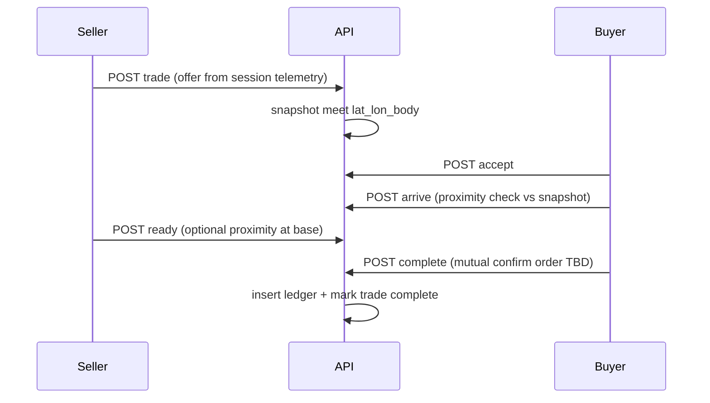

# Player-to-player trade contracts

**Overview:** Add a minimal cross-player trade contract flow: the seller lists an offer anchored to a surface location (from their session telemetry), the buyer accepts and must satisfy a server-side proximity check, completion uses mutual confirm plus a persisted ledger. Career funds gate “money” when the game reports career mode and balance; otherwise trades settle with ledger-only (unlimited) semantics.

## Implementation checklist

- [ ] Add `gameMode` + `careerFunds` to plugin telemetry and backend schema/types (`TowerTelemetryPublisher.cs`, `api.ts` zod, `store.ts`)
- [ ] Add `trade_contracts` + `trade_ledger` tables in `db.ts` (init / `addColumnIfMissing` style)
- [ ] Implement trade repository + REST routes (create/list/get/accept/arrive/complete/cancel) with proximity via a shared geometry helper
- [ ] Minimal `TradesPage` + `App` route + API client calls
- [ ] Minimal in-game create/list/complete hooks calling the same API

---

## Reality check (KSP constraints)

The backend already sees **live vessel resources** on telemetry ([`backend/src/services/store.ts`](../backend/src/services/store.ts) — `TelemetrySample.resources`; validated in [`backend/src/routes/api.ts`](../backend/src/routes/api.ts) telemetry schema), but **cannot move fuel between saves**. v1 should treat the server as **contract + location proof + payment ledger**, while **in-game transfer** remains the players’ responsibility (docking, fuel lines, etc.). Optional later: stricter plugin “handshake” when both report compatible resource deltas.

## Proximity and coordinates

Reuse the same pattern as Dragon Radar claims in [`backend/src/services/repository.ts`](../backend/src/services/repository.ts): `telemetryPositionOf`, `normalizeDragonBodyName`, `bodyRadiusM`, `greatCircleMeters`, 3D distance vs a cap (today `DRAGON_RADAR_RULES.claimRadiusM` is **1500 m** — consider a separate `tradeMeetRadiusM`, likely larger for bases).

Reference (existing code):

```3162:3277:KSCTowerNetwork-dev/backend/src/services/repository.ts
function greatCircleMeters(
  lat0: number,
  lon0: number,
  lat1: number,
  lon1: number,
  radiusM: number
): number {
  // ...
}

function telemetryPositionOf(session: SessionRecord | undefined): TelemetryPosition | undefined {
  // ...
}

// claimSessionDragonBall: body match + great circle + alt delta vs claimRadiusM
```

**Listing location:** When the seller creates a contract, snapshot `bodyName`, `lat`, `lon`, `aslAlt` (and optional `persistentId` from telemetry if present in schema) from **their authorized session** so the meet point does not drift if they fly away later.

## Career money vs “infinite” sandbox

- **Plugin:** Extend telemetry (or a small adjunct JSON block the plugin already posts) with e.g. `gameMode: "SANDBOX" | "CAREER" | "SCIENCE_SANDBOX"` and `careerFunds` (double) from KSP’s funding API when in flight / applicable. There is **no** `Funding` usage in [`PluginSrc`](../PluginSrc) today; add this in [`PluginSrc/TowerTelemetryPublisher.cs`](../PluginSrc/TowerTelemetryPublisher.cs) and mirror types in backend `store.ts` / `api.ts` zod schema.
- **Server:** On pay-with-credits leg:
  - If last known mode is **career** and funds are present: require `buyerFunds >= price` at accept or at complete (pick one consistent gate; complete is stricter).
  - If **sandbox** or funds missing: **do not reject** for insufficient balance; still write **ledger rows** (`amount`, `fromUserId`, `toUserId`, `tradeId`, `mode`, `fundsObserved`, `unlimitedSettlement: true`).

Ledger lives in **MySQL** (same style as [`backend/src/lib/db.ts`](../backend/src/lib/db.ts) `initDbSchema`), not only in-memory — trades should survive restart.

## Contract lifecycle (minimal but coherent)



Suggested statuses: `open` → `accepted` → `buyer_at_site` (after proximity) → `completed` / `cancelled` / `expired`. **Mutual confirm:** both parties must call complete (or “sign” flags on the row) within a TTL so one side cannot lock the other.

**Auth:** Tie actions to `req.auth.userId` and resolve **session** via existing session membership patterns (same family as `loadSessionIfAuthorized` / pilot checks in [`backend/src/routes/api.ts`](../backend/src/routes/api.ts)). Buyer/seller are user ids; store both `sellerUserId` and optional `sellerSessionId` at creation for auditing.

**Discovery:** Minimal `GET /v1/trades?status=open` (paginated) + `GET /v1/trades/:id`. Cap list rate and row count. Optional: notify via existing DM thread (`/v1/dm/...` in `api.ts`) on accept — not required for thin slice.

## Thin slice: web + plugin

| Layer | Minimal deliverable |
|--------|---------------------|
| **DB** | `trade_contracts` (id, seller_user_id, buyer_user_id nullable, status, body, lat, lon, alt, offer JSON, ask JSON, expires_at, created_at, …) + `trade_ledger` (id, trade_id, kind, from_user, to_user, amount, meta_json, created_at). Add tables + `addColumnIfMissing` pattern in [`backend/src/lib/db.ts`](../backend/src/lib/db.ts). |
| **API** | New router section in [`backend/src/routes/api.ts`](../backend/src/routes/api.ts): create, list, get, accept, mark-arrived (proximity), complete (dual confirm), cancel. New repository module e.g. `tradeContracts.ts` to avoid further growth of [`repository.ts`](../backend/src/services/repository.ts). Capabilities: reuse `chat:session`-style auth or add `trade:write` / `trade:read` for tighter RBAC. |
| **Web** | One page (e.g. new [`web/src/pages/TradesPage.tsx`](../web/src/pages/TradesPage.tsx)) + route in [`web/src/App.tsx`](../web/src/App.tsx): list open trades, detail drawer, buttons for accept / I’m on site / complete. Reuse existing `apiCall` / query hooks. |
| **Plugin** | (1) Publish `gameMode` + `careerFunds`. (2) Small UI: “Create trade from current vessel” (POST via existing HTTP client patterns) and “My open trades” poll. Place UI near an existing panel (e.g. ACARS/radio) to avoid a large new subsystem. |

## Out of scope for first slice

- Automatic fuel deduction / escrow inside KSP.
- Cross-body delivery without player flight.
- Full marketplace search (filters, reputation-weighted pricing).

## Testing

- Unit tests: proximity helper (extract to pure function e.g. `tradeGeometry.ts`), state machine transitions, career vs sandbox payment rules.
- Optional integration test against in-memory DB if patterns exist; otherwise manual QA with two sessions.
