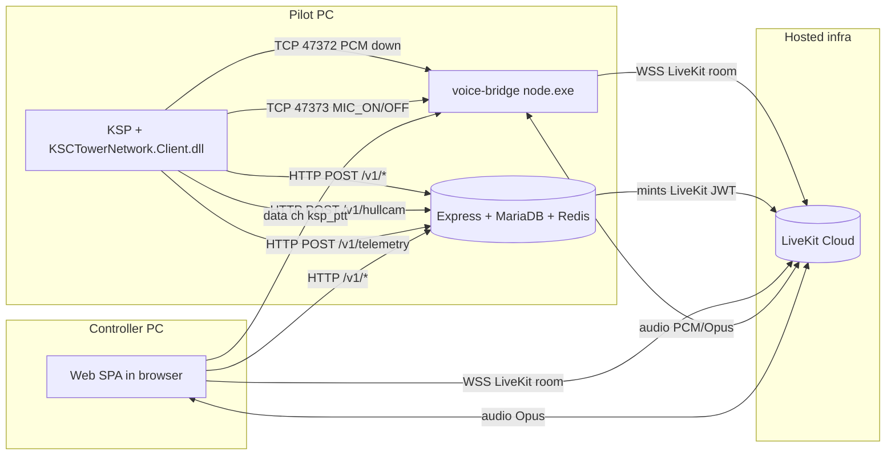

# KSCTowerNetwork — Project Overview

The single canonical reference for this codebase. Read this first; jump to
the per-subsystem docs in [`docs/`](docs/README.md) or the linked plan
documents for deep detail.

> Audience: humans onboarding the project, and AI coding agents that need to
> ground themselves in 5 minutes before touching code.

> **Looking for a specific subsystem?** See [`docs/`](docs/README.md):
> [`ARCHITECTURE`](docs/ARCHITECTURE.md) · [`PERFORMANCE_AND_HOT_PATHS`](docs/PERFORMANCE_AND_HOT_PATHS.md) ·
> [`BACKEND`](docs/BACKEND.md) ·
> [`WEB_SPA`](docs/WEB_SPA.md) ·
> [`PLUGIN`](docs/PLUGIN.md) ·
> [`VOICE_BRIDGE`](docs/VOICE_BRIDGE.md) ·
> [`API_REFERENCE`](docs/API_REFERENCE.md) ·
> [`AUTH_AND_ROLES`](docs/AUTH_AND_ROLES.md) ·
> [`SETTINGS_REFERENCE`](docs/SETTINGS_REFERENCE.md) ·
> [`DEVELOPMENT`](docs/DEVELOPMENT.md) ·
> [`DEPLOYMENT`](docs/DEPLOYMENT.md) ·
> [`TROUBLESHOOTING`](docs/TROUBLESHOOTING.md) ·
> [`GLOSSARY`](docs/GLOSSARY.md).

---

## 1. What this thing is

**KSCTowerNetwork** is a Kerbal Space Program multi-machine "air-traffic
control" experience. A pilot runs KSP with the mod installed. A controller
opens a web app in any browser. They share:

- **Voice** — duplex realtime audio (LiveKit Cloud).
- **Telemetry** — pilot's vessel position/altitude/heading/etc. POSTed to the
  backend, drawn on the controller's map.
- **Text** — ACARS-style chat (in-game panel + web Chat Desk + DMs).
- **Hull-cam video** — pilot's JRTI HullCam JPEGs forwarded to the controller's
  Tower Desk (~1 Hz).
- **Tower-side controls** — queues, role-gated session ownership, scoring,
  countdown HUDs, runway/world map awareness, moderation.

There is **no shared physics, no shared save**. It's an ATC layer on top of
otherwise-vanilla KSP.

The longer-term vision (see plan docs in §11) layers in flight strips,
clearance workflows, ghost traffic in-game, an in-game tower view stream, ATIS
broadcast, and multi-seat controller roles (ground, approach, range safety).

---

## 2. Repo layout — three trees on one disk

This source snapshot has fresh Git history. Root README, LICENSE, NOTICE.md, and
REPOSITORY_SETUP.md document its scope and publication status. DLLs, compiled
bridge runtime files, portable Node, user settings, and auth/invite stores are
local build/runtime outputs rather than tracked source. Optional chart bundles, font binaries and cached game maps are excluded. Server owners can install charts separately; see AEROCHART_REFERENCE.md. Earth topo adaptations retain CC BY-SA 4.0.
The runtime layout below describes a built installation, not a fresh clone.

The KSP install root contains **three separate trees** that work together:

```
<KSP root>/
├── GameData/KSCTowerNetwork/                  ← (1) RUNTIME install  (what KSP loads)
│   ├── Plugins/KSCTowerNetwork.Client.dll       compiled C# plugin
│   ├── Patches/*.cfg                            ModuleManager patches
│   ├── Props/                                   IVA props (RPM mic PTT)
│   ├── Scripts/{acars.ks, acars_lib.ks}         kOS scripts auto-deployed
│   └── PluginData/
│       ├── settings.cfg                         user-edited config
│       ├── settings.example.cfg                 template, never overwritten
│       ├── auth.cfg                             persisted login token + beacon
│       └── bridge-runtime/
│           ├── start-bridge.cmd                 launcher
│           ├── node/node.exe                    bundled portable Node x64
│           └── app/dist/bridge.js               compiled voice-bridge
│
├── KSCTowerNetwork-dev/                       ← (2) DEV WORKSPACE  (sources, NOT loaded by KSP)
│   ├── PluginSrc/*.cs                           C# plugin sources
│   ├── backend/                                 Express + TS API (Node)
│   ├── web/                                     Vite + React SPA
│   ├── build-plugin.ps1                         compiles PluginSrc → Plugins/*.dll
│   ├── package.json                             `npm run dev` runs all three
│   ├── *_PLAN.md / *_CATALOG.md / AUDIT.md      design docs (this file's siblings)
│   └── PROJECT_OVERVIEW.md                      ← you are here
│
└── KSCTowerNetwork-voice-bridge/              ← (3) VOICE BRIDGE source
    └── voice-bridge/
        ├── src/bridge.ts                        Node app: LiveKit ↔ TCP PCM/PTT
        └── scripts/
            ├── build-bridge-runtime.ps1         compiles + stages into (1)
            └── package-release.ps1              builds a player-distributable ZIP
```

The dev workspace `KSCTowerNetwork-dev/` and `KSCTowerNetwork-voice-bridge/`
are deliberately **outside** `GameData/`. KSP scans every file in `GameData/`
on boot — node_modules, source, READMEs, and large loose assets would each add seconds to
load and break the localizer. `build-plugin.ps1` enforces this with a hygiene
check that fails the build if anything other than `Plugins/`, `Patches/`,
`Props/`, `PluginData/`, `Localization/`, or `Scripts/` appears under
`GameData/KSCTowerNetwork/`.

> Naming nit: `KSCTowerNetwork-voice-bridge/` contains *another* folder
> `voice-bridge/` inside it. The inner one is what's actually used. The outer
> level has its own `package.json` for legacy reasons (single-file `src/bridge.ts`
> kept around). Always operate on the inner `voice-bridge/voice-bridge/`.

---

## 3. Components

### 3.1 Backend (`KSCTowerNetwork-dev/backend/`)

- Express 5 + TypeScript, single process, single `/v1/*` router.
- Persistence: MariaDB + Redis when reachable; falls back to in-process
  `Map`/`Set` (`DEV_IN_MEMORY=1`).
- Auth: three token types — `tower_web` (web user JWT), `plugin_session` (KSP
  plugin JWT), `guest` (anonymous browser viewer JWT) — all signed with
  `APP_JWT_SECRET`. Optional Clerk verification via `CLERK_SECRET_KEY` /
  `CLERK_JWT_KEY`. Dev shortcut: `DEV_OPEN_AUTH=1` maps every request to
  `DEV_USER_ID` unless a real `tower_web` JWT is presented.
- LiveKit: server SDK mints per-room JWTs; backend computes `canPublish`
  per role (pilot + assigned tower can publish; mods/admins subscribe).
- Roles: `guest < pilot < controller < mod < supermod < owner`. `OWNER_USER_ID`
  is hard-pinned and immune from bans/role changes. Capabilities derive from
  role rank, e.g. `voice:speak` requires ≥pilot, `mod:ban_perm` requires ≥supermod.
- Default ports: API on **`48787`** (production), Vite dev web on **`45173`**,
  **live UDP ingest** on **`48788`** (plugin binary telemetry / queries when
  enabled), PCM TCP **`47372`** and control TCP **`47373`** between KSP and the
  local voice bridge. **Firewall and HTTP↔UDP fallback** are spelled out in
  [`docs/ARCHITECTURE.md`](docs/ARCHITECTURE.md#ports-firewall-and-live-transport);
  **hot routes + profiling** in [`docs/PERFORMANCE_AND_HOT_PATHS.md`](docs/PERFORMANCE_AND_HOT_PATHS.md).

Key files:

| Path | Purpose |
|---|---|
| `src/index.ts` | HTTP server, live UDP/WS attach, pilot-idle sweep, graceful shutdown. |
| `src/pilotIdleSessionSweep.ts` | Timer-driven soft-close of tower sessions with stale telemetry (`PILOT_IDLE_*` env). |
| `src/config/env.ts` | Zod schema + production guards (refuses to boot with `DEV_*` flags or default JWT secret in prod). |
| `src/middleware/auth.ts` | Token verification, role/capability gates, IP-ban gate. |
| `src/routes/api.ts` | All HTTP endpoints (~57 KB; one big router). |
| `src/services/repository.ts` | DB+Redis+in-memory repository (sessions, users, queues, bans, mutes, scoring, messages). The hub. |
| `src/services/livekit.ts` | Token issuance, room lifecycle, kick, revoke publish. |
| `src/services/pluginAuth.ts` | Code-exchange flow that hands KSP a `plugin_session` JWT. |
| `src/services/webAuth.ts` | Email/password login → `tower_web` JWT. |
| `src/services/guestAuth.ts` | Anonymous lobby viewers → `guest` JWT. |
| `src/services/scoring.ts` | Detects landing/launch events from telemetry; awards points. |
| `src/services/hullcamStore.ts` | In-memory ring of recent JPEG frames per `(sessionId, cameraId)`. |
| `src/services/worldInventory.ts` | Per-session record of which planet pack / launch sites the pilot's KSP install has. |
| `src/services/worldMaps.ts` | Catalog of map basemaps + navaids per body. |
| `src/lib/db.ts` | MariaDB pool + schema bootstrap. |
| `src/lib/redis.ts` | Redis client + ping. |

### 3.2 Web SPA (`KSCTowerNetwork-dev/web/`)

- Vite + React 18 + TypeScript, `react-router-dom` v6.
- Talks to backend via relative `/v1/...` (proxied by Vite in dev, same-origin
  in single-origin prod, or `VITE_API_BASE` for split-origin prod).
- LiveKit client (`livekit-client` + `@livekit/krisp-noise-filter`) for voice.
- Routes (see `src/App.tsx`):
  - `/login` — email/password (dropdown of presets in dev).
  - `/lobby` — list of rooms / DM peers / public chat. Default landing page.
  - `/room/:roomId` — text chat + voice (LiveKit) for one session.
  - `/dm` — direct-message threads.
  - `/tower` — controller workstation (queue, strips, map, hull cams, voice).
    Requires `controller:assume` capability.
  - `/admin` — bans, mutes, role grants, reports, logs. Requires mod+.
- `src/audio/kerbalizer*.ts` — outbound mic DSP (high-pass, band-limit, soft
  saturation, formant peaking). Uses AudioWorklet with biquad fallback.

Key files:

| Path | Purpose |
|---|---|
| `src/App.tsx` | Router + auth gate. |
| `src/api/client.ts` | `apiFetch()` wrapper with bearer header + dev-voice-id header. |
| `src/auth/session.ts` | LocalStorage user + token persistence; capability checks. |
| `src/components/AppShell.tsx` | Nav + role-aware menu. |
| `src/components/HullCamPanel.tsx` | Polls `/hullcam` and renders frames. |
| `src/components/PilotProfile.tsx` | Pilot identity card. |
| `src/pages/TowerDesk.tsx` | The big one (~90 KB) — controller's full workstation. |
| `src/components/TowerWall.tsx` | Customizable monitor wall; per-pilot status + telemetry cards (`status` / legacy `telemetry` slot). |
| `src/pages/RoomPage.tsx` | Per-session chat + voice page. |
| `src/pages/AdminDesk.tsx` | Moderation UI. |
| `src/voice/livekit.ts` | LiveKit connect/publish/subscribe wrapper (`connectVoiceRoom`, token flavors), remote audio attach, Krisp toggle, `subscribeIncomingLevel` (incoming meter; analyser + time-domain RMS). |
| `src/audio/kerbalizer.ts` + `kerbalizerProcessor.worklet.ts` | The Kerbal-voice effect chain. |
| `src/scoring/rules.ts` | Mirrors backend scoring for client-side preview. |
| `src/data/{kerbinNavaids,kerbinLaunchSites,worldInventoryClient,worldMapsClient}.ts` | Static + dynamic world data. |
| `src/session/*` | Checklists, countdown, scorecard, voice panel sub-widgets. |
| `web/scripts/{build_kerbin_basemap.py,gen_kerbin_navaids.py,inspect_scansat.mjs}` | Build-time generators for the basemap SVG and navaid table. |

### 3.3 KSP plugin (`KSCTowerNetwork-dev/PluginSrc/*.cs`)

Compiled by `build-plugin.ps1` into `GameData/KSCTowerNetwork/Plugins/KSCTowerNetwork.Client.cs`.
Built against KSP's bundled `Assembly-CSharp.dll` + `UnityEngine.*` modules
under `KSP_x64_Data/Managed`.

| File | Role |
|---|---|
| `TowerModSettings.cs` | Loads `PluginData/settings.cfg` and `auth.cfg`; spawns and reaps the voice bridge child process; central read-only-ish config holder. |
| `TowerSecureStore.cs` | DPAPI-ish wrapper for storing the bearer token under Windows. |
| `TowerApiAuth.cs` | Adds `Authorization: Bearer <jwt>` to outgoing `UnityWebRequest`s. |
| `TowerLoginGui.cs` | Email/password popup; calls `/auth/login`, stores `tower_web` JWT + role. |
| `TowerToolbar.cs` | KSP `ApplicationLauncher` button → shows `TowerRadioGui`. Gates on login. |
| `TowerRadioGui.cs` | The "tower radio" IMGUI panel (~37 KB): power, channel dial, RX/TX VU meters, hold-to-talk bar, settings popover. Owns PTT keyboard handling. |
| `TowerMicMeter.cs` | Sample local mic level so the radio can show a TX VU meter without occupying the mic for capture. |
| `TowerVoicePlayback.cs` | TCP client that pulls PCM s16le mono from the bridge (port 47372) and plays it as a streaming `AudioClip` in KSP. |
| `TowerVoiceBridgeControl.cs` | Background TCP queue that sends `MIC_ON` / `MIC_OFF` / `PING` to the bridge control port (47373). Never blocks the main thread. |
| `TowerVoiceBridgeRespawnQueue.cs` | If the playback TCP keeps failing, re-spawn the bridge. |
| `TowerVoiceBridgeLauncher.cs` | `[KSPAddon(FlightAndKSC, true)]` — spawns `start-bridge.cmd` once at game start. |
| `TowerVoiceBridgeMenuQuit.cs` | Ensures the child process is killed when KSP quits from the main menu. |
| `TowerVoiceAutoConnect.cs` | After login, opens the listen socket and (optionally) toggles the mic bridge so the player doesn't have to click Connect. |
| `TowerMainThreadDispatcher.cs` | `Run(action)` for callbacks that must hit the Unity main thread. |
| `TowerTelemetryPublisher.cs` | `[KSPAddon(Flight)]` coroutine: every 5 s (or 1 s under 15 km AGL), sends telemetry of the active vessel (**UDP** when `useUdpLiveTransport`, else **`POST /v1/telemetry`**); honors the player-toggled "beacon" master switch. Adaptive interval reads `nextTelemetrySeconds` from the **HTTP JSON** or **UDP reply** (see `ParseNextInterval`). |
| `TowerHullCamRelay.cs` | Polls JRTI HullCam local HTTP at `127.0.0.1:8080`, POSTs JPEGs to backend `/hullcam/{sessionId}/{camId}`. Long back-off if JRTI not installed. |
| `TowerCountdownState.cs` | In-memory snapshot of the synced launch countdown. Server epoch translated to local `Time.realtimeSinceStartup`. |
| `TowerCountdownHud.cs` | IMGUI countdown overlay during flight. |
| `TowerWorldInventory.cs` | One-shot scan at SpaceCenter entry: reports planet pack, navaids, launch sites, KK/MAS presence to the backend so the web map adjusts. |
| `TowerAcarsToolbar.cs` | Second app-launcher button for the chat panel. |
| `TowerAcarsGui.cs` | In-game ACARS chat panel (~39 KB): polls session + DM messages; sends drafts. Mirrors web `RoomPage`/`DmDesk`. |
| `TowerAcarsKosBridge.cs` | File-mailbox between backend ACARS and the kOS Archive (`Ships/Script/`). Auto-deploys `acars.ks` and `acars_lib.ks` from `GameData/KSCTowerNetwork/Scripts/`. |
| `KSCTowerRpmMic.cs` | RasterPropMonitor `JSIActionGroupSwitch` plugin: an IVA cockpit button that sends `MIC_ON`/`MIC_OFF` to the bridge. |

### 3.4 Voice bridge (`KSCTowerNetwork-voice-bridge/voice-bridge/`)

- Tiny Node app (~390 LOC) that joins LiveKit as a fixed identity (default
  `ksp_bridge`) and bridges audio in two halves:
  - **Downlink** (room → KSP): mixes all subscribed remote audio tracks
    (`AudioMixer` from `@livekit/rtc-node`) into one s16le mono 48 kHz stream
    and broadcasts to any TCP client connected on `127.0.0.1:47372`. Header
    line: `TOWER_PCM s16le 48000 mono\n`.
  - **Uplink (PTT only)**: TCP control commands `MIC_ON` / `MIC_OFF` on
    `127.0.0.1:47373` are forwarded as a LiveKit data-channel JSON packet
    `{type:"ksp_ptt", on:bool, from:"ksp_bridge"}`. The web tab listens for
    that packet and toggles its own browser mic. This deliberately avoids
    bundling a native mic-capture lib (PortAudio's segfault handler used to
    crash @livekit/rtc-node).
- Watchdog: `KSP_WATCHDOG=1` polls `tasklist` for `KSP_x64.exe` every 5 s; if
  KSP has been gone for 3 polls (~15 s) the bridge cleanly disconnects and
  exits. The plugin also `taskkill`s the child process on KSP quit.
- Reconnect: handles `RoomEvent.Disconnected` with token refresh + exponential
  backoff (capped at 30 s).
- Token fetch: `POST {TOWER_API_BASE}/session/{SESSION_ID}/livekit-token`
  with `x-ksc-voice-identity: ksp_bridge` header, retried up to 40× at 1 s
  interval (covers the case where the bridge starts before the backend is up).

The shipped runtime in `GameData/KSCTowerNetwork/PluginData/bridge-runtime/`
includes a portable Windows x64 `node.exe` so end users do not need to install
Node.

---

## 4. Architecture



Two important asymmetries:

1. **The pilot's KSP does not speak WebRTC.** It only speaks plain HTTP (to the
   backend) and plain TCP (to its local bridge). All RTC complexity lives in
   the bridge or the browser.
2. **Voice room name is `tower-{sessionId}`.** Token issuance enforces who can
   publish based on `pilotUserId` / `assignedTowerUserId` on the session row.

---

## 5. Auth & roles in one page

| Role | Rank | Capabilities (cumulative) |
|---|---|---|
| `guest` | 0 | `chat:lobby` |
| `pilot` | 1 | + `chat:session`, `chat:dm`, `voice:speak`, `plugin:use` |
| `controller` | 2 | + `controller:assume` |
| `mod` | 3 | + `mod:mute`, `mod:ban_temp`, `mod:ban_ip` |
| `supermod` | 4 | + `mod:ban_perm` |
| `owner` | 5 | + `owner:grant_role` |

Token types (all signed with `APP_JWT_SECRET`):

- `tower_web` — issued by `POST /v1/auth/login`. Stored in browser
  localStorage and (optionally) in the KSP plugin's `auth.cfg`.
- `plugin_session` — issued by `POST /v1/auth/plugin/exchange` after the web
  client requested a one-time exchange code. KSP-only.
- `guest` — issued by `POST /v1/guest/session`. Browser-only, IP-bannable.
- (Optional) Clerk session JWT — verified via `verifyToken` if
  `CLERK_SECRET_KEY` / `CLERK_JWT_KEY` are set.

`OWNER_USER_ID` is environmental: that user id always resolves to `owner`
regardless of the DB, and cannot be banned/demoted. Set it to your
admin account in any deployment you actually care about.

Production guards in `backend/src/config/env.ts` refuse to boot if any of
`DEV_OPEN_AUTH`, `DEV_BEARER_SECRET`, `DEV_VOICE_IDENTITY_HEADER`,
`DEV_DEFAULT_WEB_USER`, `DEV_IN_MEMORY` are set, or if `APP_JWT_SECRET` is
left at its dev default.

---

## 6. HTTP API (selected — see `backend/src/routes/api.ts` for the full list)

Auth + identity:
```
POST /v1/auth/login                   email/password → tower_web JWT
GET  /v1/auth/me                      role + capabilities for the bearer
POST /v1/auth/plugin/exchange-code    web-side: get short-lived code
POST /v1/auth/plugin/exchange         KSP-side: code → plugin_session JWT
POST /v1/guest/session                anonymous → guest JWT
```

Tower queue + sessions:
```
POST /v1/queue/join                   join the tower controller queue
POST /v1/queue/leave
POST /v1/session/call                 pilot raises a call → sessionId returned
GET  /v1/session/:sid                 session record + latest telemetry
POST /v1/session/:sid/next-tower      rotate controller
POST /v1/session/:sid/block           block a user
POST /v1/session/:sid/clearance        controller: structured clearance strip (DB `clearances_json`)
POST /v1/session/:sid/expected-runway controller: expected landing runway id (wrong-runway RP)
POST /v1/session/:sid/runway-occupancy controller: manual runway occupied flag (in-memory)
```

Chat (session, lobby, DM):
```
GET  /v1/session/:sid/messages?since=ISO
POST /v1/session/:sid/messages
GET  /v1/lobby/messages
POST /v1/lobby/messages
GET  /v1/lobby/rooms
GET  /v1/dm/peers
GET  /v1/dm/:peer/messages
POST /v1/dm/:peer/messages
```

Telemetry / hull cam / world:
```
POST /v1/telemetry/:sid               KSP plugin heartbeat (drives map + scoring + countdown + tower hooks; reply includes clearances echo, violations, phase timeline, approach #, landing tier)
POST /v1/hullcam/:sid/:camId          JPEG frame upload
GET  /v1/hullcam/:sid                 list + recent frame for each cam
POST /v1/world/inventory/:sid         pilot's planet/navaid scan
GET  /v1/world/maps                   basemap manifest for current body
```

Voice:
```
POST /v1/session/:sid/livekit-token   → { token, wsUrl, roomName, canPublish, canSubscribe }
```

ATIS (KSC D-ATIS text; Phase 1 — no TTS / audio URL yet):
```
GET  /v1/atis/current                 authed: broadcast text + NATO letter + hashes
POST /v1/atis/admin/force-advance     mod+: bump letter manually
POST /v1/atis/admin/regen             mod+: re-read weather file, same letter
```

Moderation / admin:
```
POST /v1/report
GET  /v1/admin/reports
POST /v1/admin/ban
POST /v1/admin/mute
POST /v1/admin/role
GET  /v1/admin/logs
GET  /v1/admin/rooms/tower            active tower sessions
GET  /v1/admin/rooms/chat             chat traffic by sessionId
```

---

## 7. Settings reference

### Backend env (see `backend/.env.example`)

| Var | Purpose |
|---|---|
| `NODE_ENV` | `development` / `production`. Production triggers all the safety guards. |
| `PORT` | Listen port (default `48787`). |
| `APP_JWT_SECRET` | Long random secret. **Required in prod.** |
| `LIVEKIT_API_KEY` / `LIVEKIT_API_SECRET` / `LIVEKIT_WS_URL` | From LiveKit Cloud project. |
| `LIVEKIT_BRIDGE_IDENTITIES` | CSV of identities treated as the KSP voice-bridge (default `ksp_bridge`). |
| `MARIADB_*` / `REDIS_URL` | Persistence. |
| `CORS_ORIGINS` | CSV allowlist. Empty in prod = no cross-origin browsers (loopback only). |
| `WEB_LOGIN_USERS_JSON` | JSON array `[{userId,email,password,role}]` for the email/password login. |
| `OWNER_USER_ID` | Hard-pinned owner. |
| `ADMIN_USER_IDS` | Legacy admin allowlist (still respected by some routes). |
| `CLERK_SECRET_KEY` / `CLERK_JWT_KEY` | Optional Clerk verification path. |
| `TELEMETRY_DEFAULT_SECONDS` / `TELEMETRY_CLOSE_SECONDS` / `TELEMETRY_CLOSE_AGL_M` | Adaptive cadence knobs. |
| `ATIS_WEATHER_PATH` | Static KSC weather JSON for ATIS text (default `./data/atis.weather.json`, cwd = `backend/`). |
| `ATIS_TICK_SECONDS` | ATIS scheduler interval (default `30`). |
| `ATIS_MIN_ADVANCE_SECONDS` | Minimum wall time between NATO letter advances (default `60`; set `0` locally to test advances quickly). |
| `DEV_OPEN_AUTH` / `DEV_BEARER_SECRET` / `DEV_USER_ID` / `DEV_USER_ROLE` | Dev shortcuts (banned in prod). |
| `DEV_VOICE_IDENTITY_HEADER` | When `DEV_OPEN_AUTH=1`, lets a request introduce its own identity (used by the bridge and for two-tab tests). |
| `DEV_IN_MEMORY` | Force in-memory persistence even if MariaDB is reachable. |
| `DEV_DEFAULT_WEB_USER` | Allow the built-in `tower@ksc.local` / `tower12345` login as a fallback. |

### Web env (see `web/.env.example`, `web/.env.production.example`)

| Var | Purpose |
|---|---|
| `VITE_API_BASE` | Backend origin in split-origin prod. Unset = relative `/v1` (single-origin or Vite dev proxy). |
| `VITE_DEV_LOGIN_PRESETS` | JSON array fueling the dev login dropdown. Gated on `import.meta.env.DEV`. |

### KSP plugin (`PluginData/settings.cfg` — see `settings.example.cfg`)

| Key | Purpose |
|---|---|
| `towerApiHost` / `towerApiPort` / `towerApiPath` / `towerApiTls` | Backend URL. Split keys because KSP's ConfigNode parser treats `//` inside a value as a comment. |
| `sessionId` | Tower channel name (`dev-shared`, `tower-public`, …). |
| `voiceListenHost/Port` | Where `TowerVoicePlayback` connects to the bridge. |
| `voiceCtlHost/Port` | Where `TowerVoiceBridgeControl` sends `MIC_ON`/`OFF`. |
| `pushToTalkKey` | Unity `KeyCode` name (default `R`). |
| `autoStartVoiceBridge` | Spawn `start-bridge.cmd` at game start. |
| `bridgeExecutable` / `bridgeWorkingDirectory` / `bridgeArguments` | Launcher knobs. |
| `bridgeEnv_*` | Any env var prefixed `bridgeEnv_` is passed through to the child process. |
| `skipTowerLogin` | Bypass the login window (for dev backends with `DEV_OPEN_AUTH`). |
| `rememberTowerEmail` / `persistTowerSessionToken` | Persist credentials into `auth.cfg`. |
| `kosBridgeEnabled` / `kosBridgeArchivePath` / `kosBridgeAutoInstallScript` / `kosBridgePollSeconds` | kOS ACARS bridge. |
| `EnableHullCamRelay` / `HullCamFps` / `HullCamJrtiBaseUrl` / `HullCamMaxBytes` | JRTI HullCam relay. |

### Voice bridge env (read by `bridge.ts`)

`TOWER_API_BASE`, `SESSION_ID`, `PCM_HOST/PORT`, `CTL_HOST/PORT`,
`KSP_WATCHDOG`, `KSP_PROCESS_NAME`, `KSP_WATCH_INTERVAL_MS`,
`KSP_WATCH_MISSES_BEFORE_EXIT`, `BRIDGE_IDENTITY`, `DEV_VOICE_IDENTITY_HEADER`.

---

## 8. Dev workflow

From `KSCTowerNetwork-dev/`:

```powershell
npm run install             # or plain npm install — same bootstrap
npm run dev                 # starts backend + web + bridge concurrently
                            # backend  127.0.0.1:48787
                            # web      127.0.0.1:45173 (proxies /v1 → 48787)
                            # bridge   127.0.0.1:47372 (PCM) + 47373 (CTL)
```

`npm run dev` first calls `dev:clean-ports` which kills anything still
listening on the four dev ports — protects against orphaned processes from a
crashed previous run.

Plugin build (KSP must be **closed**, it locks the DLL):

```powershell
cd KSCTowerNetwork-dev
.\build-plugin.ps1
```

This compiles every file in `PluginSrc/` listed in the script's `$src` array
into `GameData/KSCTowerNetwork/Plugins/KSCTowerNetwork.Client.dll`, then runs
the GameData hygiene check (see §2).

Voice bridge runtime build (regenerates `PluginData/bridge-runtime/`):

```powershell
cd KSCTowerNetwork-voice-bridge\voice-bridge
.\scripts\build-bridge-runtime.ps1 -NodeExePath "<path to node.exe>"
```

End-user release ZIP:

```powershell
cd KSCTowerNetwork-voice-bridge\voice-bridge
.\scripts\package-release.ps1     # reads release-config.json
```

### Test login presets (dev)

Local `backend/.env.development` (from `.env.example`) has three accounts:

| Email | Password | Role |
|---|---|---|
| `admin@ksc.local` | `admin12345` | owner |
| `controller@ksc.local` | `controller12345` | controller |
| `pilot@ksc.local` | `pilot12345` | pilot |

The web LoginPage exposes them in a dropdown (see `VITE_DEV_LOGIN_PRESETS`).

### Two-tab voice testing

With `DEV_OPEN_AUTH=1` and `DEV_VOICE_IDENTITY_HEADER=x-ksc-voice-identity`,
each browser tab can introduce itself as a different identity by filling the
"Dev voice id" box on the Voice panel (e.g. `pilot1` and `tower1`). Align
`pilotUserId` / `assignedTowerUserId` on the session record so both can
publish.

---

## 9. Production deployment

Detailed in [`HOSTING.md`](HOSTING.md) and [`PRODUCTION_DEPLOYMENT_PLAN.md`](PRODUCTION_DEPLOYMENT_PLAN.md). Summary:

1. **Pick three URLs**: backend API, web SPA, LiveKit WSS.
2. **Fill `release-config.json`** (template at `release-config.example.json`)
   so `package-release.ps1` bakes the hosts into `settings.cfg`,
   `start-bridge.cmd`, and the SPA build.
3. **Backend** on Railway / Fly / VPS with: `NODE_ENV=production`,
   `APP_JWT_SECRET`, LiveKit creds, `CORS_ORIGINS=https://your.web.host`,
   MariaDB + Redis, `WEB_LOGIN_USERS_JSON` (or Clerk), `OWNER_USER_ID`.
4. **Web** built with `VITE_API_BASE=https://api.your.host` and deployed to a
   static host (or single-origin behind the backend).
5. **LiveKit Cloud** project; paste API key/secret/WS URL into backend env.
6. **Players** download the release ZIP, drop `GameData/KSCTowerNetwork/`
   into their KSP install, optionally edit `PluginData/settings.cfg` if your
   hostname differs from the baked default.

Production safety guards (in `env.ts`) prevent the most common foot guns —
see [`AUDIT.md`](AUDIT.md) for the full security review.

---

## 10. KSP mod dependencies

None of the mods below are *strictly* required for the DLL to load — the plugin
detects each one via reflection and silently no-ops if it isn't present. But if
you want every advertised feature to work, install them. CKAN identifiers match
`ckan/KSCTowerNetwork.netkan`.

| Mod | CKAN id | Tier | What it unlocks | What you lose without it |
|---|---|---|---|---|
| **ModuleManager** | `ModuleManager` | Required for patches | Applies `GameData/KSCTowerNetwork/Patches/*.cfg` (`MM_HookCommRadio.cfg`, `MM_AddTowerMicProp_DE_mk1Cockpit.cfg`). Listed as a hard `depends` in CKAN. | Patches are skipped: IVA PTT prop never spawns, comm-radio hook never attaches. The compiled C# (`KSCTowerNetwork.dll`) still loads and the toolbar/HUD still work. |
| **RasterPropMonitor** (RPM) | `RasterPropMonitor` | Recommended | `KSCTowerRpmMic.cs` (`JSIActionGroupSwitch` IVA prop `pb_KSCTOWER_mic_PTT`) + the RPM half of `KSCTowerCommRadioPtt.cs` / `TowerCommRadioFreqSync.cs` that watch the ASET COMM Radio dial's persistents. | No in-cockpit IVA push-to-talk button, no IVA freq sync. Toolbar `R`-key PTT and the radio panel still work. |
| **HullcamVDSContinued** (JRTI HullCam) | `HullcamVDSContinued` | Recommended | `TowerHullCamRelay.cs` polls JRTI's local HTTP server at `127.0.0.1:8080` and POSTs JPEGs to `/v1/hullcam/{sessionId}/{camId}` for the Tower Desk `HullCamPanel`. | Tower-side hull-cam panel stays empty. Relay backs off silently with a long retry. |
| **kOS** | `kOS` | Recommended | Two independent integrations: (a) `TowerAcarsKosBridge.cs` writes ACARS messages into the kOS Archive (`Ships/Script/`) so KerboScript can read/send tower text via the auto-installed `acars.ks` / `acars_lib.ks`; (b) `TowerKosScreenAutoCapture.cs` mirrors **all** kOS terminal output to the web `KosScreenPanel` via reflection on `kOS.Module.kOSProcessor` (no compile-time dep on `kOS.dll`). | ACARS-from-kerboscript stops working; the web KosScreenPanel never fills. Web ACARS chat still flows normally. |
| **AvionicsSystems** (MAS / MOARdV) | `AvionicsSystems` | Recommended (alternate to RPM) | The MAS half of `KSCTowerCommRadioPtt.cs` / `TowerCommRadioFreqSync.cs` reads the same ASET COMM Radio persistents (`ASET_COMM_RADIO_PTT_PRESS`, `ASET_COMM_RADIO_ACTIVE_FREQ`) via MAS's `Get/SetPersistent` API instead of RPM's. | If your IVA is MAS-only (no RPM) you lose the in-cockpit PTT + freq sync from that pod. Other cockpits unaffected. |
| **Chatterer** | `Chatterer` | Optional — not recommended | `TowerChattererDuck.cs` mutes Chatterer (and ASET COMM fake `ATC_*` samples) while PTT is open so they do not bleed into your transmission. We do not use Chatterer for features — it is defensive only; live human ATC overlaps badly with simulated chatter, so most players leave it off. | Nothing required from Chatterer. CKAN lists it under `suggests` only so installs that already have it are handled; see `INTEGRATIONS.md`. |
| **ASET-Props** | `ASET-Props` | Cosmetic / asset pack | Provides the visual model for `pb_KSCTOWER_mic_PTT` and the ASET COMM Radio prop whose persistents the comm-radio hooks watch. | The IVA PTT button shows as a missing prop in any cockpit that places it; the comm-radio integrations have nothing to listen to. |
| **ASET-Avionics** | `ASET-Avionics` | Cosmetic / asset pack | The avionics-prop dependency of the ASET COMM Radio prop (lights, dial textures, etc.). | Same as above — broken visuals on the ASET radio prop. |
| **DE-IVAExtension** | `DE-IVAExtension` | Cosmetic / cockpit-specific | Required by `MM_AddTowerMicProp_DE_mk1Cockpit.cfg` (`:NEEDS[RasterPropMonitor&DE_IVAExtension]`) to splice the PTT prop into the Deadly Edition mk1 cockpit IVA at the position next to Chatterer's PTT. | That specific cockpit doesn't get the IVA PTT button. Other DE/RPM cockpits (which match different patches, or none yet) are unaffected. |

CKAN ships the catalog declaration roughly aligned to these tiers:

- `depends`: `ModuleManager`
- `recommends`: `RasterPropMonitor`, `ASET-Props`, `ASET-Avionics`
- `suggests`: `AvionicsSystems`, `DE-IVAExtension`, `Chatterer`, `kOS`, `HullcamVDSContinued`

`Chatterer` is **not** recommended (same rationale as `INTEGRATIONS.md`); it appears in `suggests` so CKAN users who already run it get a known compatibility path, not as encouragement to install it.

`HullcamVDSContinued` and `kOS` are filed as `suggests` in CKAN today even
though they unlock major features, because some controllers/pilots prefer to
run a leaner install. Move them up to `recommends` in your fork if your tower
community treats those features as standard.

---

## 11. Plan & design docs

These are companion documents in this folder. Read the relevant one before
implementing a feature; they contain the actual design intent and slot the
work into the existing code precisely.

| Doc | Scope |
|---|---|
| [`REAL_TOWER_ROADMAP.md`](REAL_TOWER_ROADMAP.md) | Authoritative ATC-mechanics roadmap: voice reliability, multi-aircraft map, flight strips, runway state, sequencing, handoff, alerts, timeline. Phased delivery plan. |
| [`ROLEPLAY_FEATURES_CATALOG.md`](ROLEPLAY_FEATURES_CATALOG.md) | Catalog of immersion features (squawk, callsigns, per-frequency channels, kneeboard, METAR, NOTAM, multi-role seats, scoring loops). Sized as "what + where + why," not implementation. |
| [`GHOSTS_AND_TOWER_VIEW_PLAN.md`](GHOSTS_AND_TOWER_VIEW_PLAN.md) | In-game ghost traffic from other pilots' telemetry + tower-view hull-cam stream. Pilot-to-pilot symmetric design. |
| [`TELEMETRY_AND_TOWER_TRACKING_PLAN.md`](TELEMETRY_AND_TOWER_TRACKING_PLAN.md) | Aggregate telemetry surface for the controller; superseded in part by the ghost plan. |
| [`VOICE_IMPLEMENTATION_PLAN.md`](VOICE_IMPLEMENTATION_PLAN.md) | Voice + Kerbalizer DSP workstream breakdown (parallel AI execution playbook). |
| [`ATIS_PLAN.md`](ATIS_PLAN.md) | Auto-generated ATIS broadcast loop with local Piper TTS, LiveKit injector bot, NATO-letter advancement on material change. |
| [`HOSTING.md`](HOSTING.md) | Going-live checklist. The single source of truth for hostnames is `release-config.json`. |
| [`PRODUCTION_DEPLOYMENT_PLAN.md`](PRODUCTION_DEPLOYMENT_PLAN.md) | Older deployment walkthrough; useful for the per-platform recipes (Railway / Vercel / etc.). |
| [`AUDIT.md`](AUDIT.md) | Repo-wide security/reliability audit. Critical / High / Medium / Low. Don't ship prod without skimming the Critical section. |
| [`TEST_COVERAGE_PLAN.md`](TEST_COVERAGE_PLAN.md) | Roadmap for automated tests (backend HTTP, auth, web, plugin/bridge, CI). Stub at `KSCTowerNetwork-dev/TEST_COVERAGE_PLAN.md` points here. |
| `KSCTowerNetwork-voice-bridge/voice-bridge/RUNTIME_DISTRIBUTION.md` | End-user distribution recipe for the bridge runtime + ZIP layout. |

---

## 12. Known foot guns (skim before editing)

From `AUDIT.md` — the issues most likely to bite an editor today:

- **Default web credentials** (`tower@ksc.local` / `tower12345`) ship as a
  fallback when `WEB_LOGIN_USERS_JSON` is unset. Production guard does **not**
  block this — set the JSON or set `DEV_DEFAULT_WEB_USER=0`.
- **Tower-queue race**: `nextTowerExcluding` then `assignTower` is read-then-write
  without a row lock. Two pilots calling at once can be assigned the same
  controller. Plan: Lua script or `SELECT … FOR UPDATE`.
- **`bans` table key collision**: ban + mute share `PRIMARY KEY (user_id)` so
  a mute upsert overwrites a ban row. Plan: composite `(user_id, kind)`.
- **Plugin synchronous TCP on the main thread** (`TowerRadioGui`,
  `KSCTowerRpmMic`) used to freeze KSP for 20 s when the bridge wasn't running.
  Mostly fixed via `TowerVoiceBridgeControl.EnqueueSend`; do not regress to
  direct `TrySendLine` from a UI handler.
- **`RoomPage` cleanup leak** on remote disconnect: only clears `handleRef`
  but not the mic meter / `getUserMedia` track / RAF subscriber.
- **Voice bridge unbounded control-socket buffer** (no `\n` ever ⇒ OOM).
- **JWT in plaintext under `GameData`**: `auth.cfg` stores the bearer + email
  without DPAPI on Windows.
- **`MARIADB_PASSWORD=""` / `MARIADB_USER=root`** as defaults.

Severity-tagged details and the rest of the list are in `AUDIT.md`.

---

## 13. Glossary

- **ACARS** — text messaging between pilot and tower (in-game panel + web
  Chat Desk + DMs + the kOS file mailbox).
- **Beacon** — pilot-side toggle that pauses telemetry POSTs without
  disconnecting voice. Persists in `auth.cfg`.
- **Bridge** — the local Node process that joins LiveKit on KSP's behalf.
  Runs alongside KSP, exits when KSP exits.
- **Ghost** — render-only proxy of another pilot's vessel, driven by their
  telemetry. Planned (see `GHOSTS_AND_TOWER_VIEW_PLAN.md`).
- **Hull cam** — JPEG frames from JRTI HullCam (a dependency mod) forwarded
  to the controller's Tower Desk.
- **JRTI** — *Just Read The Instructions*, an external KSP mod whose local
  HTTP server exposes camera snapshots. The plugin polls it; if it isn't
  installed the relay backs off silently.
- **kOS** — *Kerbal Operating System*, an external KerboScript mod. Our ACARS
  bridge uses its `Ships/Script/` Archive folder as a file mailbox so a
  KerboScript program can read/send tower text.
- **Kerbalizer** — the outgoing-mic DSP chain (radio bandpass + saturation +
  formant peaking) that gives voice the ATC-radio character.
- **RPM** — *RasterPropMonitor*, an external IVA cockpit-display mod. We ship
  one prop (`pb_KSCTOWER_mic_PTT`) for in-cockpit PTT.
- **Strip** — flight strip, a per-aircraft workflow card on the Tower Desk
  (planned; see `REAL_TOWER_ROADMAP.md` §3).
- **Tower-eligible role** — `controller` or higher. Drives publish permissions
  on voice and visibility of admin-ish UI.
- **Tower view** — a **flight** KSP client with a Hullcam VDS + JRTI stack,
  stationary near KSC, streaming JPEGs as `KSC-TOWER-*` when **Stream as Tower**
  is on (web: `view-streams` + HullCam panel). Not the Space Centre UI camera;
  see [DISABLED_FEATURES.md](DISABLED_FEATURES.md) / [GHOSTS_AND_TOWER_VIEW_PLAN.md](GHOSTS_AND_TOWER_VIEW_PLAN.md) Part B.

---

## 14. Licensing

KSCTowerNetwork code, configs, schemas, scripts and original art are released
under the **MIT License** (see [`LICENSE`](LICENSE)).

Some bundled **map** art is third-party work and carries its own license:

- **`web/public/maps/earth-topo5*.svg`** — adapted from Wikimedia Commons
  *World_topo_5layers.svg* by Dbachmann, [CC BY-SA 4.0](https://creativecommons.org/licenses/by-sa/4.0/) /
  GFDL.

Kerbin’s default tower plate is in-repo (**`kerbin-base-schematic.svg`**) or live
textures from the player’s game session — not NC-licensed chart plates.

Third-party notes for anything else live in [`NOTICE.md`](NOTICE.md).

## Optional chart installation

Third-party chart bundles are not included. `web/scripts/install_charts.py` renders and indexes a separately downloaded upstream PDF into `web/dist/charts/` after the web build (or an explicit output folder). `web/scripts/chart-requirements.txt` lists the Python dependencies. `web/scripts/install-charts.ps1` and `web/scripts/install-charts.sh` set up an isolated Python environment and run the installer. The empty Charts page links to the upstream PDF and `web/public/charts/README.md`. See [installation instructions](AEROCHART_REFERENCE.md).
