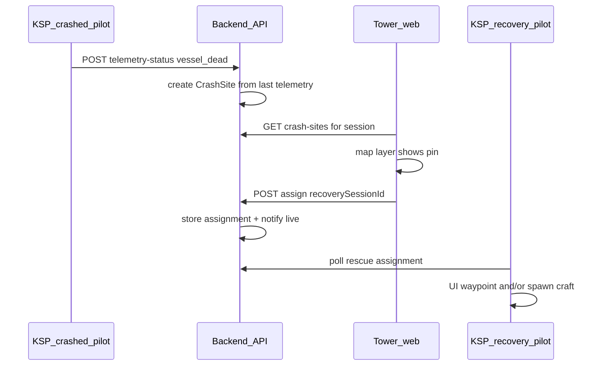

# Rescue mini-game (tower web + KSP)

**Overview:** Add crash-site records when the plugin reports `vessel_dead`, expose them to tower-room members with a Kerbin map layer toggle, let the controller assign a recovery session, and deliver the mission to the recovery pilot’s KSP client (coordinates first; optional phased vessel spawn at that lat/lon in their own save).

## Implementation todos

- [ ] Add `crash_sites` table + repository CRUD and idempotent create from `vessel_dead` + last telemetry
- [ ] Wire API routes: list by session, assign to `recoverySessionId`, complete/cancel, `GET` rescue-assignment for recovery session; live invalidation
- [ ] KerbinTowerMap crash-site markers + toolbar toggle; TowerDesk/Wall query + assign UI
- [ ] Plugin: poll rescue-assignment; new IMGUI panel; optional waypoint; later `.craft` spawn at lat/lon

## Context from the codebase

- **Crash signal already exists:** [`PluginSrc/TowerTelemetryPublisher.cs`](../PluginSrc/TowerTelemetryPublisher.cs) stops live telemetry when `v.state == Vessel.State.DEAD` and POSTs gone-dark with reason `vessel_dead` to `POST /v1/telemetry-status/:sessionId` (see [`backend/src/routes/api.ts`](../backend/src/routes/api.ts) ~3160).
- **Last position stays on the session:** `setTelemetryStatus` only sets `telemetryStatus`; it does **not** clear `session.telemetry` ([`backend/src/services/repository.ts`](../backend/src/services/repository.ts) ~2308–2319). So lat/lon/body/callsign remain available to snapshot into a crash site at `vessel_dead` time.
- **Live aircraft layer hides “dark” sessions:** [`backend/src/live/snapshotCache.ts`](../backend/src/live/snapshotCache.ts) `buildActiveAircraftBase` filters out rows where `telemetryStatus.state` is set (line ~195). A **separate** crash-site feed is required so towers still see a pin after a crash.
- **Tower room = session membership:** `GET /v1/me/active-room` in [`backend/src/routes/api.ts`](../backend/src/routes/api.ts) defines members as pilot, `assignedTowerUserId`, or `spectatorUserIds` (~1482–1485). **Visibility:** any authenticated user who is a member of the **crashed pilot’s session** may load crash sites for that session; expose a **map layer toggle** on [`web/src/components/KerbinTowerMap.tsx`](../web/src/components/KerbinTowerMap.tsx) (same pattern as existing overlay toggles, e.g. KSC / guidance layers ~3460+).
- **Separate KSP instances:** Recovery happens in the **recovery pilot’s** game; coordinates from the crashed pilot’s telemetry are still meaningful for navigation (same body lat/lon). Spawning a lander “at the crash” means spawning **in the recovery client’s universe** at those coordinates—not a shared multiplayer world.

## Data model and backend

1. **Persist crash sites** (recommended over pure in-memory): add a `crash_sites` table in [`backend/src/lib/db.ts`](../backend/src/lib/db.ts) (`CREATE TABLE IF NOT EXISTS`) with at least: `id`, `source_session_id`, `created_at`, `body_name`, `lat`, `lon`, `asl_alt` (optional), `callsign`, `craft_name`, `pilot_user_id`, `crew_json` (optional, from telemetry `crewNames` / count), `status` (`open` | `assigned` | `completed` | `cancelled`), `assigned_recovery_session_id` (nullable), `assigned_at`, `completed_at`. Repository helpers in [`backend/src/services/repository.ts`](../backend/src/services/repository.ts): create on first `vessel_dead` for a session (idempotent: upsert or “only if no open site”), update assignment, complete/cancel.

2. **Hook creation on `vessel_dead`:** In the handler for `POST /telemetry-status/:sessionId` in [`backend/src/routes/api.ts`](../backend/src/routes/api.ts), after `setTelemetryStatus`, if `parsed.data.state === 'vessel_dead'` and `existing.telemetry` has finite `lat`/`lon`, call `createCrashSiteFromSession(...)`. Emit live invalidation (reuse `publishLiveSnapshotEvent` with a new topic such as `crash-sites` or invalidate session snapshot for `source_session_id`).

3. **HTTP API** (all under `/v1`, auth + session membership):

   - `GET /session/:sessionId/crash-sites` — returns open/recent sites for **that** session; authorize with the same policy as other session reads (`loadSessionIfAuthorized` / `chat:session`).
   - `POST /session/:sessionId/crash-sites/:crashId/assign` — body `{ recoverySessionId: string }`; only controller (or mod) for **source** session; verify recovery session exists and pilot is active; set `assigned_recovery_session_id`.
   - `POST /session/:sessionId/crash-sites/:crashId/complete` (controller or recovery pilot) / `cancel` (controller/mod).
   - `GET /session/:sessionId/rescue-assignment` — for the **recovery** session: returns the active crash row assigned to this `sessionId` (for plugin polling).

4. **Optional ACARS:** On assign, `appendSessionMessage` to both sessions with a short `[RESCUE]` line so chat-only clients still see the dispatch.

## Web UI

1. **Data hook:** `useApiQuery` in [`web/src/pages/TowerDesk.tsx`](../web/src/pages/TowerDesk.tsx) / [`web/src/components/TowerWall.tsx`](../web/src/components/TowerWall.tsx) (wherever `KerbinTowerMap` is fed) for `GET …/crash-sites` keyed by the desk’s `sessionId`, with refetch aligned to live WebSocket if you already invalidate on session events, else modest polling.

2. **Kerbin map layer:** In [`web/src/components/KerbinTowerMap.tsx`](../web/src/components/KerbinTowerMap.tsx), add props `crashSites?: CrashSiteMarker[]` and a toolbar toggle (persisted with other map toggles when `persistKey` is set). Render markers with distinct icon (wreck/distress) and a small modal: callsign, body, coords, status, **Assign recovery** dropdown listing other sessions the controller can see (start with **other `active`/`assigned` lobby rooms** from existing `lobby/rooms` or a narrow `GET` that lists assignable recovery sessions—keep the first version simple: mod/controller-only list of open pilot sessions excluding self).

3. **Recovery operator UX:** If the current user is the pilot of `assigned_recovery_session_id`, show a banner or strip on the desk linking to coords (reuse existing telemetry/label components where possible).

## KSP plugin UI and mission delivery

1. **Poll endpoint:** New coroutine loop (similar rhythm to [`PluginSrc/TowerDragonRadarGui.cs`](../PluginSrc/TowerDragonRadarGui.cs) `PollLoop`) or a thin helper called from an existing periodic tick: `GET /v1/session/{sessionId}/rescue-assignment` while in flight / space center as needed.

2. **IMGUI panel:** New small window (e.g. `TowerRescueMissionGui.cs`) showing active assignment: body, lat/lon, distance/bearing if current vessel is on same body, **Set custom waypoint** if you already have waypoint helpers elsewhere; otherwise text copy is enough for v1.

3. **Spawn “lander can” (phased):**

   - **v1:** Mission text + coordinates + optional waypoint only (low risk, ships quickly).
   - **v2:** Bundle a minimal `.craft` under `GameData/KSCTowerNetwork/` and spawn via KSP APIs (position from `lat`/`lon` on `FlightGlobals.Bodies[body]` + terrain sample height). Requires careful testing on your target KSP version; no existing spawn logic in this repo besides [`PluginSrc/TowerGhostFleet.cs`](../PluginSrc/TowerGhostFleet.cs) (render proxies, not recoverable craft).

4. **Telemetry enrichment (optional):** If you want kerbal **names** at the site, extend [`PluginSrc/TowerTelemetryPublisher.cs`](../PluginSrc/TowerTelemetryPublisher.cs) JSON to include `crewNames` / counts at crash time (some of this may already exist in `BuildTelemetryJson` for crew).

## Edge cases to handle in code

- **No coords:** If `vessel_dead` fires without valid `lat`/`lon` (map screen / invalid body), skip creating a site or create with `status: pending_coords` and no map pin until tower manually places (manual pin is a nice follow-up, not required for MVP).
- **Deduping:** Rapid double POSTs from plugin—make creation idempotent.
- **Session close:** Decide whether open crash sites auto-cancel when `closeSession` runs; recommend **keep** for debrief or **cancel** with audit row—pick one and document in handler next to `closeSession` in [`repository.ts`](../backend/src/services/repository.ts).

## Files likely touched (summary)

| Area | Files |
|------|--------|
| Schema + repo | [`backend/src/lib/db.ts`](../backend/src/lib/db.ts), [`backend/src/services/repository.ts`](../backend/src/services/repository.ts) |
| Routes | [`backend/src/routes/api.ts`](../backend/src/routes/api.ts) |
| Live cache | [`backend/src/live/snapshotCache.ts`](../backend/src/live/snapshotCache.ts) or small dedicated cache module + WS invalidation in [`backend/src/live/wsTransport.ts`](../backend/src/live/wsTransport.ts) |
| Web map | [`web/src/components/KerbinTowerMap.tsx`](../web/src/components/KerbinTowerMap.tsx), [`web/src/pages/TowerDesk.tsx`](../web/src/pages/TowerDesk.tsx) / [`web/src/components/TowerWall.tsx`](../web/src/components/TowerWall.tsx) |
| Plugin | New `TowerRescueMissionGui.cs`, wire toggle in [`PluginSrc/TowerModSettings.cs`](../PluginSrc/TowerModSettings.cs) / existing GUI registry, rebuild via [`build-plugin.ps1`](../build-plugin.ps1) |

## Rollout order

1. DB + repo + `vessel_dead` hook + read/list APIs.
2. Web map layer + assign/cancel/complete.
3. Plugin poll + IMGUI mission panel (coords / waypoint).
4. Optional craft spawn + richer crew snapshot.
