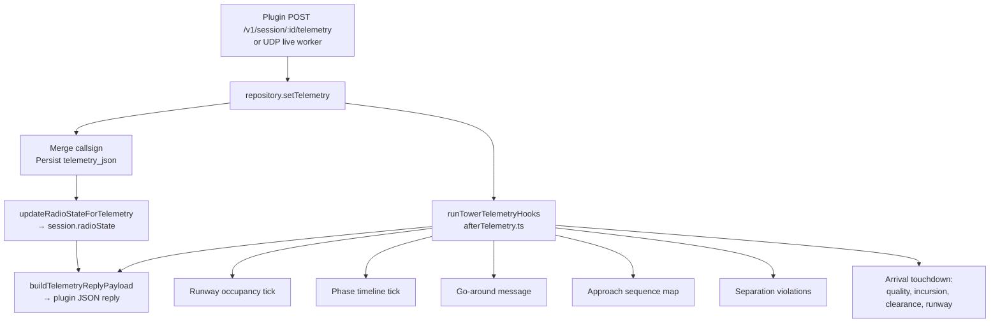

# Tower logic — current behavior

Authoritative reference for **shipped** tower derivation rules in
`backend/src/tower/`. These modules are pure (or mostly pure) logic plus a few
in-memory stores. They run on every successful telemetry ingest.

**Not covered here:** future roadmap items in [`REAL_TOWER_ROADMAP.md`](REAL_TOWER_ROADMAP.md),
[`RUNWAY_LOCKS_PLAN.md`](RUNWAY_LOCKS_PLAN.md), Ground seat, formal clearance
workflows beyond what the hooks already read. Treat `*_PLAN.md` as intent; treat
this doc + tests as **what the server does today**.

**Tests:** `backend/src/tower/*.test.ts` · **mutation gate:** `npm run test:mutation`
(≥80% on the modules listed below) · see [`DEVELOPMENT.md`](DEVELOPMENT.md).

---

## Telemetry flow

Every pilot/plugin telemetry sample that lands in `setTelemetry()` updates
`session.radioState` immediately. Tower **hooks** run afterward (best-effort;
never fail the HTTP/UDP response).

| Step | File | Side effects |
|---|---|---|
| Persist + radio | `services/repository.ts` → `setTelemetry` | DB/memory, live snapshot events |
| Hooks | `tower/afterTelemetry.ts` | Session messages, violations, phase timeline, landing quality |
| Reply | `tower/telemetryReplyPayload.ts` | JSON returned to plugin (cadence, radio, sequence, …) |

Hook-local dedupe (separate from violation dedupe):

| Map | Cooldown | Purpose |
|---|---|---|
| `goAroundLast` | 50 s | One `[GO_AROUND]` system line per session |
| `separationPairLast` | 30 s | One loss-of-separation burst per aircraft pair |

---

## Module reference

### `geo.ts` — great-circle distance

**Intent:** Horizontal distance in km between two lat/lon points on a spherical
body (default Kerbin radius 600 km).

| Input | Notes |
|---|---|
| `lat1, lon1, lat2, lon2` | Degrees |
| `bodyRadiusM` | Default `600_000` |

**Output:** Distance in km (0 for identical points).

**Used by:** `approachQueue` (gap behind leader), `separation` (horizontal
separation).

---

### `approachQueue.ts` — arrival sequencing

**Intent:** For each `(bodyName, activeRunway)` group, rank aircraft that are
**on approach** so the tower UI can show “#2 of 4, 0.01 km behind leader”.

**Inclusion:** Row must have `onApproach === true` and non-empty `activeRunway`
(after trim).

**Sort order** (stable comparator, first key wins):

1. `distKSC` ascending (missing → `+∞`, sorted last)
2. `alignErr` ascending (missing → `999`)
3. Altitude descending: `radarAlt ?? aslAlt ?? +∞` — **higher** alt → **later**
   in queue (farther from runway in typical approach geometry)
4. `sessionId` lexicographic tie-break

**Output per session:** `{ index, of, gapKmBehindLeader? }`

- `index` is 1-based position in the group
- `gapKmBehindLeader` is haversine km to the previous row **only** when both
  rows have finite lat/lon; otherwise `undefined`

**Not modeled:** wake turbulence, speed, ETA, controller manual reorder.

---

### `separation.ts` — loss-of-separation pairs

**Intent:** Flag aircraft pairs that are **too close** horizontally and
vertically on the **same body**.

| Threshold | Value |
|---|---|
| Horizontal | `< 2` km (haversine) |
| Vertical | `< 300` m (`|radarAlt − radarAlt|`, fallback `aslAlt`) |

**Skipped when:** different `bodyName`, any lat/lon missing/non-finite, either
altitude non-finite.

**Output:** Unordered list of `{ sessionA, sessionB, callsignA?, callsignB? }`
(session ids sorted lexicographically in the pair key used by hooks).

**Hook behavior:** For each new pair (30 s dedupe), both sessions get a
`LOSS_OF_SEPARATION` violation + system chat line if `pushViolationEvent`
allows.

---

### `flightEdges.ts` — touchdown and go-around detection

**Intent:** Distinguish **arrival** ground transitions from pad hops / noise,
and detect **missed approach** climb-outs near the field.

#### Ground detection (`situationGrounded`)

`situation` string (case-insensitive) contains `LANDED`, `SPLASHED`, or
`PRELANDED`.

#### Approach intent (`publisherLandingApproachIntent`)

True when `landing === true` **or** `flightPhase` contains `APPROACH` or
`LANDING`.

#### Departure climb (`publisherDepartureClimbPhase`)

True when `flightPhase` contains `TAKEOFF` or `CLIMB`. Used to **suppress**
arrival touchdown on the **previous** sample (pad hop after takeoff).

#### Touchdown transition (`isTouchdownTransition`)

Previous sample airborne + current sample grounded.

#### Arrival touchdown (`isArrivalTouchdown`)

Touchdown transition **and** previous sample **not** in departure climb phase.
Drives landing messages and runway violations in hooks.

#### Missed approach (`missedApproachCandidate`)

All must hold on **current** sample unless noted:

| Rule | Condition |
|---|---|
| On approach | `curr.onApproach === true` |
| Near field | `distKSC < 3000` (missing → no trigger) |
| Approach intent | prev **or** curr has approach intent |
| Climb signal | `verticalSpeed > 2` m/s **or** altitude gain `> 8` m vs prev |

---

### `phaseTimeline.ts` — canonical phase strip

**Intent:** Derive a coarse **OUT / OFF / APP / ON / IN** timeline per session
with hysteresis so brief telemetry flicker does not spam phase changes.

#### Single-tick phase (`deriveCanonicalPhase`)

Priority order:

1. **Grounded** (`situation` grounded):
   - `IN` if `flightPhase` contains `TAXI` **and** `radarAlt > 20`
   - else `ON`
2. **`APP`** if `onApproach === true`
3. **Kerbin distance** when `bodyName === "Kerbin"` and finite `distKSC`:
   - `OUT` if `distKSC >= 150_000`
   - else `OFF`
4. Other airborne bodies → `OFF`
5. Fallback → `OUT`

#### Dwell (`phaseTimelineTick`)

- First sample for a session → commit immediately, append timeline entry
- Phase change → start **4 s** candidate timer; commit only after dwell
- Candidate change before commit → reset timer
- Returns `{ code, at }` to append, or `null`

Timeline capped at **32** entries on the session (`afterTelemetry`).

---

### `runwayState.ts` — runway occupancy (heuristic)

**Intent:** Track which session likely occupies a runway for incursion checks
and tower awareness. **Not** a formal runway lock (see `RUNWAY_LOCKS_PLAN.md`).

**Key:** `{bodyName}:{runwayId.trim()}`

#### Telemetry heuristic (`tickRunwayOccupancyFromTelemetry`)

**On surface** when all true (missing metrics default high so they fail):

| Metric | Threshold |
|---|---|
| `radarAlt` | `< 55` m |
| `surfaceSpeed` | `< 38` m/s |
| `alignErr` | `< 14` |

Sets `occupied`, `bySessionId`, preserves `sinceMs` for same session.

**Clear** when same session was occupant and (`radarAlt > 200` **or**
`surfaceSpeed > 55`).

**Manual override** (`setRunwayManualOverride`): telemetry ticks ignored until
cleared.

#### Landing mark (`markRunwayLanding`)

Sets `lastLandingAtMs`, keeps occupancy.

---

### `landingQuality.ts` — touchdown tier

**Intent:** Qualitative landing grade from the **last on-approach** sample
stored in hooks (`shortFinal` map), not a numeric scoreboard.

Missing `alignErr` → treated as `99` (worst). Missing `verticalSpeed` → `0`.

| Tier | Condition |
|---|---|
| `OFF_CENTER` | `alignErr > 8` **or** `\|verticalSpeed\| > 6` m/s |
| `HARD` | `alignErr > 4` **or** `\|verticalSpeed\| > 3.5` m/s |
| `GOOD` | otherwise |

Written to `session.lastLandingQuality` on arrival touchdown.

---

### `violations.ts` — violation events

**Kinds:** `LANDING_NO_CLEARANCE`, `RWY_INCURSION`, `LOSS_OF_SEPARATION`,
`WRONG_RUNWAY`

**Dedupe:** Per `(sessionId, kind)`, **45 s** — repeated pushes return `null`.

**Display lines:** Fixed tower strings (e.g. `VIOLATION: RWY INCURSION`).

**Hook triggers:**

| Kind | When |
|---|---|
| `LOSS_OF_SEPARATION` | Separation pair detected (see above) |
| `RWY_INCURSION` | Arrival touchdown while runway occupied by **another** session |
| `LANDING_NO_CLEARANCE` | Touchdown and `session.clearances.LANDING !== "cleared"` |
| `WRONG_RUNWAY` | Touchdown and `expectedLandingRunway` set and normalized id ≠ active runway |

Recent violations kept on session (max **16** in hook append; **8** in telemetry
reply payload).

---

### `radioState.ts` — frequency busy / blocked

**Intent:** Model **half-duplex radio** per 25 kHz channel for plugin/UI
(`FREQ BUSY`, `BLOCKED - SAY AGAIN`). Updated on **every** `setTelemetry`, not
only in `afterTelemetry`.

| Constant | Value | Meaning |
|---|---|---|
| `CHANNEL_STEP_MHZ` | 0.025 | Snap frequency to grid |
| `BUSY_HOLD_MS` | 2500 | Transmitter stays “busy” after last PTT-updated sample |
| `BLOCKED_HOLD_MS` | 6000 | Blocked state visible to both parties |
| `BLOCK_DEDUPE_MS` | 4000 | Same pair/channel block event dedupe |

**Behavior summary:**

- Valid finite `radioFreqMhz` required; else `undefined` state
- PTT **on**: if another session holds channel within busy window → **blocked**
  for both; else become occupant
- PTT **off** by occupant → release channel
- Retune away → release previous channel if this session held it
- Callsign priority: `session.callsign` → telemetry `callsign` → `pilotName`

State exposed on session and in telemetry reply `radio` field.

---

### `afterTelemetry.ts` — hook orchestration

**Entry:** `runTowerTelemetryHooks(sessionId, prev, curr, session)`

**Order of work:**

1. Runway occupancy tick (if body + runway present)
2. Phase timeline tick → maybe append to `session.phaseTimeline`
3. Missed approach → maybe `[GO_AROUND]` message (50 s dedupe)
4. If `curr.onApproach`, refresh `shortFinal` align/VS snapshot
5. Recompute **global** approach sequence for all sessions with telemetry
6. Recompute separation conflicts → violations + messages (30 s pair dedupe)
7. If **arrival touchdown**:
   - Landing quality + `[LANDING]` message
   - Runway incursion check + `markRunwayLanding`
   - Clearance + expected-runway violation checks
   - Live snapshot events

**Error policy:** Swallow all errors — telemetry ingest must never fail because
of tower logic.

**Returns:** `{ approachSequence }` for the requesting session (may be `null`).

---

### `telemetryReplyPayload.ts` — plugin reply shape

**Intent:** Pack tower-facing state into the JSON body returned from
`POST .../telemetry` (and UDP reply).

Includes: cadence (`nextTelemetrySeconds`), countdown, takeoff clearance window,
clearances, recent violations, phase timeline tail, **radio**, approach sequence,
landing quality, staging move request.

Cadence uses `TELEMETRY_CLOSE_AGL_M` / `TELEMETRY_*_SECONDS` from env when
`radarAlt` is low; countdown can force 1 s polling.

---

## Related code outside `tower/`

| Area | Role |
|---|---|
| `services/repository.ts` | Session fields, `setTelemetry`, clearance storage |
| `routes/api.ts` | Telemetry POST, clearance endpoints, tower HTTP API |
| `live/udpWorker.ts` | Same hooks on UDP telemetry path |
| `web/src/tower/*` | Client-side track/guidance helpers (separate tests) |

---

## When you change tower logic

1. Update the matching section in **this file** (intent + thresholds).
2. Extend **`src/tower/*.test.ts`**.
3. Run **`npm run test:mutation`** if you touched a gated module.
4. If behavior is **new product surface** (not just tuning), note it in
   [`REAL_TOWER_ROADMAP.md`](REAL_TOWER_ROADMAP.md) or mark plan items done.

---

## Implemented vs planned (quick map)

| Feature | Status |
|---|---|
| Approach sequence ordering | **Shipped** (`approachQueue`) |
| Separation conflict alert | **Shipped** (heuristic, chat + violation) |
| Runway occupancy heuristic | **Shipped** (not full lock) |
| Phase timeline OUT/OFF/APP/ON/IN | **Shipped** (4 s dwell) |
| Landing quality tier | **Shipped** |
| Radio busy/blocked | **Shipped** |
| Go-around detection | **Shipped** (message only) |
| Formal runway lock / reservation | **Planned** (`RUNWAY_LOCKS_PLAN.md`) |
| Ground seat / taxi routing | **Planned** (`GROUND_SEAT_PLAN.md`) |
| Controller handoff workflow | **Planned** (`HANDOFF_PLAN.md`) |
| Per-frequency voice rooms | **Partial / plan** (`PER_FREQUENCY_CHANNELS_PLAN.md`) |
