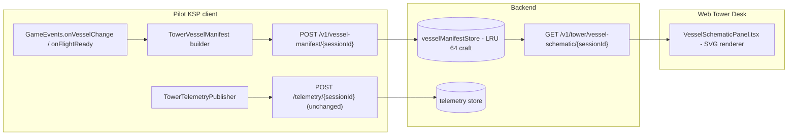

# VesselView Integration - Plan

> **Identity check first:** the mod actually present in this dev environment is the one CKAN indexes as `identifier: VesselView`, display-name "Vessel Viewer Continued", by `linuxgurugamer` (originally PeteTimesSix's). The `.version` file's `"NAME": "VesselViewerContinued"` is just internal AVC bookkeeping; the CKAN id you reference in `depends/recommends/suggests` is `VesselView` and the existing entry in [ckan/KSCTowerNetwork.netkan](ckan/KSCTowerNetwork.netkan) line 45 is correct as-is. The DLLs that actually ship are `VesselView.dll` + `VesselViewRPM.dll` + `VVPartSelector.dll` + `VVDiscoDisplay.dll`; it draws an exploded 2D schematic of the active vessel into a Toolbar window backed by a Unity `RenderTexture`, and on the IVA side it depends on **RasterPropMonitor** (per the CKAN entry's `depends`), not on **AvionicsSystems**/MAS. The wrongness in [INTEGRATIONS.md](INTEGRATIONS.md) and [ckan/README.md](ckan/README.md) is the *role and framework* of the integration, not the CKAN identifier. Phase 0 of this plan fixes that paperwork before any code lands.

## Purpose

Give web Tower Desk controllers a "schematic of the inbound vessel" view so they can spot stage configuration, missing landing gear, or asymmetric loadouts at a glance, in the same panel stack as the existing hull-cam tiles ([TowerViewPanel.tsx](web/src/components/TowerViewPanel.tsx), [HullCamPanel.tsx](web/src/components/HullCamPanel.tsx)).

There are three plausible ways to deliver that view. They are not equivalent in cost, fidelity, or fragility, so this doc evaluates all three and picks one for v1.

Cross-references: extends the per-pilot tile family in [GHOSTS_AND_TOWER_VIEW_PLAN.md](GHOSTS_AND_TOWER_VIEW_PLAN.md) Part B, reuses the JPEG upload path from [TowerHullCamRelay.cs](PluginSrc/TowerHullCamRelay.cs), and reuses the reflection-into-an-optional-mod pattern from [TowerKosScreenAutoCapture.cs](PluginSrc/TowerKosScreenAutoCapture.cs).

---

## Non-goals

- Not a full IVA / cockpit replacement. VesselView (the schematic mod) does not draw flight instruments; we do not turn this into a HUD.
- Not part-by-part interactive control. The web tile is read-only; clicking a part may highlight it, never command it.
- Not a substitute for the existing hull-cam feeds; this is an additional panel.
- Not a workaround for the (different) MAS-based "VesselView" mod. If a future player install includes that one, it gets its own integration doc.

---

## Three options, scored

| Option | What ships on the wire | Plugin code | Web code | Compile-time dep | Fragility |
|--------|------------------------|-------------|----------|------------------|-----------|
| **(1) JS schematic from telemetry** | Existing telemetry + new `partsManifest` block (per-vessel, sent once on load) | small | medium-large | none | low |
| **(2) Repurpose JRTI HullCam preset** | Same JPEG stream as today, just from a fixed iso/top boom-cam | zero | zero (docs only) | none | very low |
| **(3) Capture VesselView's RenderTexture** | New JPEG endpoint mirroring `/hullcam/...` | medium-large | small | reflection-only into VesselView.dll | medium-high |

### Why (1) wins for v1

- Telemetry already publishes `craftMapIcon`, `persistentId`, mass, part count, and walks `v.parts[i]` in [TowerTelemetryPublisher.cs](PluginSrc/TowerTelemetryPublisher.cs) (lines 977, 1371, 1554, 1585). Adding a one-shot per-vessel parts manifest is incremental, not a new feed.
- The web side is plain SVG/Canvas in `web/src/components/`. It scales to many concurrent vessels because it's static-per-vessel, not a video stream.
- Interactive: the controller can hover a part to see its name and dry mass, click a part to highlight it. JPEGs from option (3) can't do that.
- No dependency on a third-party mod whose API has been silently broken between KSP point releases before.

### Why (2) is a useful adjunct, not the answer

- A pilot can already drop a long boom with a HullCam VDS camera in iso orientation and stream it through the existing [TowerHullCamRelay.cs](PluginSrc/TowerHullCamRelay.cs) at zero new code. We document this as the "poor-man's schematic" preset and ship a `KSC-Schematic-Boom.craft` template.
- Caveats: the camera shows the vessel as it really looks (textures, fairings) which is not a schematic. It's a fallback for players who haven't installed the upstream parts-manifest version yet.

### Why (3) is parked, not killed

- VesselView has no public HTTP listener (unlike JRTI HullCam) and no public typed API for "give me your current frame" (unlike kOS). It draws into an internal `RenderTexture` from `OnGUI`. To capture it we'd need to reflect into private members, run `Graphics.Blit` + `Texture2D.ReadPixels` + `EncodeToJPG` on the main thread, and add a new backend endpoint.
- Cost is real (~400-600 LOC plugin + new endpoint + new tile + brittle dep) and the fidelity gain over option (1) is "labels match VesselView's exact font/layout."
- Re-evaluate after option (1) ships and we know what controllers actually want.

**Decision: Phase 1-3 deliver option (1). Option (2) is a Phase 0 doc/template add. Option (3) is a future Phase 5 if and only if controllers ask.**

---

## Architecture (option 1: JS schematic)



Manifest is sent **once per vessel-load** (and re-sent on stage / dock / undock events), not once per telemetry tick. The schematic is then re-rendered cheaply on the web side using static geometry plus live telemetry (orientation, fuel-level shading, stage indicator) overlaid.

---

## Phase 0 - Paperwork & low-effort wins (no plugin code)

Pre-requisite for any of the options below. Does not depend on which option we pick.

1. **Rewrite the description.** Three places currently call VesselView a "MAS-based instrument HUD." That's wrong on two counts: it pairs with **RasterPropMonitor** (per the CKAN entry's `depends`), not MAS, and its job is rendering an exploded 2D schematic of the vessel, not driving instruments. Affected:
   - [INTEGRATIONS.md](INTEGRATIONS.md) lines 108-109
   - [ckan/README.md](ckan/README.md) lines 36 and 49 (the line 36 "verify the id" hand-wringing can also be deleted - the id really is `VesselView`)
   - Suggested replacement: "Renders a 2D exploded schematic of the active vessel in a Toolbar window, with optional in-IVA prop via RasterPropMonitor. Pairs with the future Vessel Schematic web tile (see [VESSELVIEW_INTEGRATION_PLAN.md](VESSELVIEW_INTEGRATION_PLAN.md))."
2. **Document the HullCam-iso preset (option 2 fallback).** Add a paragraph to [INTEGRATIONS.md](INTEGRATIONS.md) describing the boom-mounted iso camera as a poor-man's schematic for players who don't have the schematic mod installed.

Exit: descriptions match what the player actually sees in-game. (No CKAN edits needed - the existing `"name": "VesselView"` entries in `.netkan` / `.ckan` are correct.)

---

## Phase 1 - Backend manifest store

- New table / in-memory map `vesselManifestStore` in `backend/src/services/`, keyed by `(sessionId, persistentId)` -> `{ uploadedAtMs, json }`. LRU bounded at 64 entries with a 30-minute idle eviction; it's small and bursty.
- `POST /v1/vessel-manifest/{sessionId}` - accepts a JSON body up to 64 KB (rejected at the body-limit middleware otherwise, see how [TowerHullCamRelay.cs](PluginSrc/TowerHullCamRelay.cs) sizes against the existing 512 KB limit). Body shape:

```json
{
  "persistentId": "...",
  "craftName": "Aeris 4A",
  "craftMapIcon": "plane",
  "rootPartIndex": 0,
  "parts": [
    {
      "i": 0,
      "n": "mk2Cockpit.Standard",
      "p": [0.0, 1.2, 0.0],
      "r": [0.0, 0.0, 0.0, 1.0],
      "b": [1.2, 1.0, 2.4],
      "m": 1.4,
      "parent": -1,
      "stage": 0,
      "tags": ["cockpit", "crewed"]
    }
  ]
}
```

- `GET /v1/tower/vessel-schematic/{sessionId}` - returns the latest manifest for the session, or 404. Auth-gated to any authenticated user (same shape as `/active-aircraft` in [GHOSTS_AND_TOWER_VIEW_PLAN.md](GHOSTS_AND_TOWER_VIEW_PLAN.md) Phase 1).
- Wire both endpoints into `backend/src/routes/api.ts`. Add a repo accessor in `backend/src/services/repository.ts`.

Exit: `curl -X POST` with a hand-crafted manifest comes back from the GET unchanged; oversized body returns 413; missing manifest returns 404.

---

## Phase 2 - Plugin: `TowerVesselManifestPublisher`

New `[KSPAddon(KSPAddon.Startup.Flight, false)]` MonoBehaviour modeled on [TowerTelemetryPublisher.cs](PluginSrc/TowerTelemetryPublisher.cs).

- **Trigger events:** `GameEvents.onFlightReady`, `onVesselChange`, `onVesselWasModified`, `onStageActivate`, `onPartCouple`, `onPartUndock`. Debounce: build at most one manifest per 2 s real-time even if the events burst.
- **Walk the parts tree** for the active vessel. Use `v.parts[i]` like the existing telemetry walker does (see lines 977 etc. of `TowerTelemetryPublisher.cs`). For each part record:
  - `i` - index in the array
  - `n` - `part.partInfo.name` (canonical part name; web side maps to display label)
  - `p` - position relative to root part (`part.transform.position - root.transform.position`, expressed in vessel local frame)
  - `r` - rotation quaternion relative to root
  - `b` - axis-aligned bounds extents in vessel local frame
  - `m` - dry mass (`part.mass`)
  - `parent` - index of the parent part, -1 for root
  - `stage` - `part.inverseStage`
  - `tags` - cheap classifier (cockpit, fueltank, engine, gear, wing, fairing, decoupler, control-surface, science) derived from `PartModule` presence
- **Size guard:** if the manifest exceeds `VesselManifestMaxBytes` (default 48 KB, leaving headroom under the 64 KB endpoint cap), drop low-signal parts first (struts, fuel lines, decals) and re-encode. If still over, send a truncated manifest with `truncated: true`.
- **POST** to `ApiBaseUrl + "/vessel-manifest/" + UrlEncode(sessionId)`. Mirror the auth pattern (`TowerApiAuth.ApplyBearer`) and error logging (long backoff on transient HTTP errors) from [TowerHullCamRelay.cs](PluginSrc/TowerHullCamRelay.cs).
- **Settings** in [TowerModSettings.cs](PluginSrc/TowerModSettings.cs):

| Key | Default | Notes |
|-----|---------|-------|
| `EnableVesselManifest` | true | Master toggle |
| `VesselManifestMaxBytes` | 49152 | Pre-cap fallback before truncation kicks in |
| `VesselManifestDebounceSeconds` | 2.0 | Min delay between rebuilds |

Exit: launch a stock Aeris 4A, watch one POST hit the backend within 3 s of leaving the runway, see the manifest in the GET response.

---

## Phase 3 - Web: `VesselSchematicPanel.tsx`

- New component under `web/src/components/`, modeled on [TowerViewPanel.tsx](web/src/components/TowerViewPanel.tsx) for the data-fetch + empty-state shape.
- Uses `useApiQuery` against `/v1/tower/vessel-schematic/{sessionId}` with `refetchInterval: 10_000` (manifests change rarely; we just need to pick up stage events).
- Renders SVG. Algorithm:
  1. Project each part's `(p, b, r)` onto a chosen orthographic plane (default top-down; toggle for side view).
  2. Draw a rectangle per part with stroke colored by `tags[0]` and fill alpha modulated by stage.
  3. Draw connection lines for every `parent != -1` edge (faint).
  4. Overlay a north-arrow + scale bar.
  5. Hover a rect -> tooltip with `n`, `m`, `stage`. Click -> emit a selection event (consumed later for cross-panel highlight).
- Empty state: same "Awaiting feed" treatment as `TowerViewPanel.tsx` lines 65-78.
- Mount in [TowerDesk.tsx](web/src/pages/TowerDesk.tsx) as a sibling to the Tower View tile, scoped to the currently-selected aircraft from the existing aircraft picker.

Style: reuse the existing `tower-view-panel` family of class names in [web/src/index.css](web/src/index.css) (`tower-schematic-panel`, `__head`, `__title`, `__sub`, `__empty`).

Exit: select an inbound aircraft on the Tower Desk, see its schematic; hover a wing, see "wingShuttleStrake | 0.05 t | stage -1."

---

## Phase 4 - Polish

- Stage-coloring overlay: shade parts by their `inverseStage`; click a stage indicator to dim everything else.
- Live tank-fill shading: pull resource amounts from the per-tick telemetry feed (already published) and shade fuel/oxidizer tanks proportionally.
- Crewed-part highlight: outline cockpits/cans where `protoModuleCrew.Count > 0` (telemetry already walks this; see lines 1964 / 2088 of `TowerTelemetryPublisher.cs`).
- Cross-panel selection sync: clicking a part in the schematic highlights the same part name on the parts list, hull-cam labels, and (eventually) the ghost fleet proxy.

---

## Phase 5 (deferred) - Capture VesselView's RenderTexture (option 3)

Only consider this if controllers report that the JS schematic feels insufficient and ask specifically for "what VesselView shows in-game."

Sketch only:

- Reflect into `VesselView.dll` from a new `[KSPAddon(KSPAddon.Startup.Flight, false)]` `TowerVesselViewRelay` MonoBehaviour, modeled on the reflection bootstrap in [TowerKosScreenAutoCapture.cs](PluginSrc/TowerKosScreenAutoCapture.cs) (look for `FindLoadedType` / `WalkForProperty` / `DisableReflection`).
- Locate the singleton or per-frame `RenderTexture` the schematic UI is drawing into. If no public hook exists, hook `OnGUI` via a Harmony patch (introduces a Harmony dep we currently don't carry).
- On a 1 Hz timer, `Graphics.Blit` -> `Texture2D.ReadPixels` -> `EncodeToJPG` -> POST to a new `/v1/vesselview/{sessionId}` endpoint. The endpoint mirrors the hullcam path's auth/size handling (see [TowerHullCamRelay.cs](PluginSrc/TowerHullCamRelay.cs) lines 411-442).
- Add a "VESSELVIEW" tile in `TowerDesk.tsx` that consumes it.
- Settings additions: `EnableVesselViewRelay`, `VesselViewFps`, `VesselViewMaxBytes`.

Exit: tower sees the same image VesselView shows in-game, refreshed at ~1 Hz.

---

## Risks & mitigations

| Risk | Mitigation |
|------|------------|
| Manifest endpoint becomes a DDoS vector | 64 KB body limit, 1 manifest per 2 s per session via plugin-side debounce, optional rate limit at the backend if observed in practice. |
| Manifest grows past 64 KB on absurd 600-part craft | Drop-low-signal-parts pass in `TowerVesselManifestPublisher`; truncated flag surfaced in the web tile. |
| Part naming conventions drift between KSP versions and break the SVG renderer's tag classifier | Tag classifier is defensive: an unknown part renders as a neutral grey rectangle; never throws. |
| Vessel docks/undocks rapidly and we hammer rebuilds | 2 s debounce in plugin + 10 s refetch in web. |
| Future player runs the *other* (MAS-based) mod also called "VesselView" | This plan targets only `VesselViewerContinued`; the MAS one would get a separate integration doc and would not collide on endpoint names because we use `/vessel-manifest/...` and (Phase 5) `/vesselview/...`. |
| Phase 5 reflection breaks on a VesselView point release | Same self-disable + log-once pattern as `TowerKosScreenAutoCapture.DisableReflection` (lines 293-299). The schematic tile from option (1) keeps working regardless. |

---

## Test plan

**Phase 0**

- Search [INTEGRATIONS.md](INTEGRATIONS.md), [ckan/README.md](ckan/README.md) for "MAS-based" - returns no hits.
- Search same files for "AvionicsSystems" near the VesselView paragraph - returns no hits (it's an RPM mod, not a MAS mod).

**Phase 1 (backend)**

- `POST /v1/vessel-manifest/test-session` with valid JSON returns 200; `GET` returns it back.
- Body > 64 KB returns 413.
- `GET` for unknown session returns 404, not 200-with-empty.

**Phase 2 (plugin)**

- Launch Aeris 4A from the runway: exactly one manifest POST within 3 s after `onFlightReady`.
- Stage activation: one additional POST within 2-4 s (debounce).
- Decouple a part: one additional POST within 2-4 s.
- Backend offline: log says "manifest publisher backing off", no exception spam, resumes within one debounce window after backend returns.

**Phase 3 (web)**

- Select an inbound aircraft with a manifest: schematic renders within 1 paint.
- Select an aircraft without a manifest yet: empty-state placeholder, no console error.
- Hover a wing part: tooltip shows correct part name + dry mass + stage.
- Switch top-down vs side view: both render coherently.

**End-to-end**

- Two pilot clients side-by-side, separate accounts, both fly different stock craft. Tower Desk shows the correct schematic for whichever pilot is selected and updates within 4 s when the other is selected.

---

## Files touched (forward-looking inventory)

**Phase 0 (docs only)**
- [INTEGRATIONS.md](INTEGRATIONS.md) - rewrite the VesselView paragraph (RPM not MAS, schematic not HUD)
- [ckan/README.md](ckan/README.md) - rewrite the VesselView bullet (lines 36, 49) with the same correction
- (no edits needed in `.netkan` / `.ckan` - the `VesselView` id is correct)

**Phase 1 (backend)**
- `backend/src/services/vesselManifestStore.ts` (new)
- `backend/src/routes/api.ts` (two new routes)
- `backend/src/services/repository.ts` (manifest accessor)

**Phase 2 (plugin, new)**
- `PluginSrc/TowerVesselManifestPublisher.cs` (new)
- [PluginSrc/TowerModSettings.cs](PluginSrc/TowerModSettings.cs) (3 new keys)

**Phase 3 (web)**
- `web/src/components/VesselSchematicPanel.tsx` (new)
- [web/src/pages/TowerDesk.tsx](web/src/pages/TowerDesk.tsx) (mount the new tile)
- [web/src/index.css](web/src/index.css) (`tower-schematic-panel` family)
- `web/src/query/client.ts` query-key family addition (`queryKeys.tower.vesselSchematic(sessionId)`)

**Phase 5 (deferred, plugin)**
- `PluginSrc/TowerVesselViewRelay.cs` (new)
- New backend endpoint + tile (mirrors hullcam shape)

---

## Open questions

- Do we want the manifest to include resource amounts at upload time, or always read fuel state from per-tick telemetry? (Leaning: telemetry, to keep the manifest static.)
- Should the schematic respect player privacy / scoring (e.g. hide part names on craft entered into a scored pattern competition)? Probably out of scope for v1 but worth flagging to the scoring plan.
- Phase 5: is a Harmony dep acceptable if VesselView turns out to have no field we can reflect into without one? If not, Phase 5 is permanently shelved and option (2)'s HullCam preset is the only fallback.
