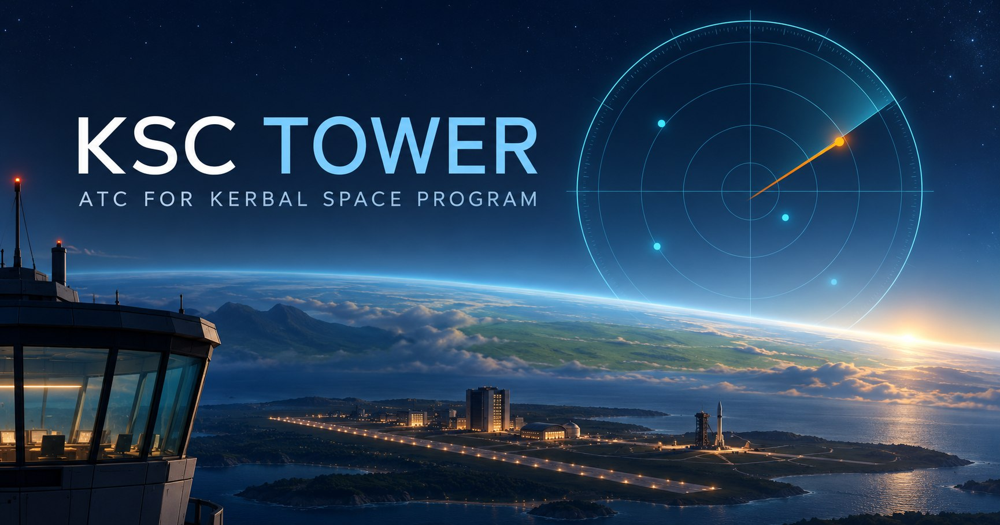

# KSCTowerNetwork

    

> **Voice, telemetry, ACARS text, and controller tools for Kerbal Space Program.**
>
> Pilots run the game with the plugin; controllers use a browser. Each player keeps their own physics and save.

  

[Start here](#start-here) · [What runs where](#what-runs-where) · [Downloads and releases](#downloads-and-releases) · [Source layout](#source-layout) · [Licenses and optional assets](#licenses-and-optional-assets)

---

## Start here

| You want to… | Read |
| --- | --- |
| Use the prebuilt server or set up an existing Linux/Windows host manually | [Server hosting: prerequisites through first login](KSCTowerNetwork-dev/docs/SERVER_HOSTING.md) |
| Install a complete backend and website on a fresh Ubuntu VPS or VM | [Ubuntu bootstrap guide](KSCTowerNetwork-dev/deploy/README.md) |
| Install optional Kerbin charts on your website | [Chart download and installation](KSCTowerNetwork-dev/docs/AEROCHART_REFERENCE.md) |
| Build or develop the game plugin, web app or player bridge | [Development](KSCTowerNetwork-dev/docs/DEVELOPMENT.md) |
| Choose required/optional player mods | [Mod integrations](KSCTowerNetwork-dev/docs/INTEGRATIONS.md) |
| Diagnose a problem or look up a setting | [Troubleshooting](KSCTowerNetwork-dev/docs/TROUBLESHOOTING.md), [settings](KSCTowerNetwork-dev/docs/SETTINGS_REFERENCE.md) |

---

## What runs where

### Server operator:

use the Ubuntu installer above for a fresh VPS or VM. It installs and configures the backend, website, database/cache, HTTPS and service startup. Existing hosts and Windows servers can use the manual hosting guide.

#### Host a tower on Ubuntu

Start with a fresh Ubuntu 22.04 or 24.04 LTS VPS or VM. Configure the installer
with your hostname, SSH key, owner login and voice settings, then run
`sudo bash setup-vps.sh`. It installs Node, MariaDB, Redis and nginx, builds
the backend and website, configures HTTPS and the firewall, and starts the
backend as a systemd service. It writes the production environment to
`/etc/ksctower.env`. Cloudflare is optional; direct HTTPS is supported.

Follow the [Ubuntu installer guide](KSCTowerNetwork-dev/deploy/README.md).
For an Ubuntu VM, give it a reachable address and forward the required ports.
Voice uses the LiveKit service configured in your server settings.

### Controller:

open the operator's HTTPS website, register with an invite or use an account supplied by the operator, and join the controller queue from the Lobby. Voice needs browser microphone permission.

### Pilot:

install a built player release into KSP, point its settings at the operator's server, and sign in/pair as described in [deployment](KSCTowerNetwork-dev/docs/DEPLOYMENT.md#client-and-server-release-zips). This source checkout contains runtime templates, not a ready-to-play DLL or bundled bridge runtime. Build/package instructions are in Development; do not tell players to copy this repository into GameData.

Pilots use the same Client ZIP and set their operator's address in
`GameData/KSCTowerNetwork/PluginData/settings.cfg`. Operators do not need
to rebuild or repackage the client for each server.

---

## Downloads and releases

A release provides separate **Client** (Windows x64 KSP plugin + voice bridge) and
**Server** (built backend + website) ZIPs. Controllers use the hosted website.
See [release build and installation](KSCTowerNetwork-dev/docs/RELEASING.md).

---

## Source layout

| Directory | Contents |
| --- | --- |
| `KSCTowerNetwork-dev/` | C# plugin source, backend, web app, build scripts and docs |
| `KSCTowerNetwork-voice-bridge/voice-bridge/` | Player voice bridge source, tests and release builders |
| `GameData/KSCTowerNetwork/` | Runtime templates, patches, IVA props and kOS scripts |

Architecture and detailed reference: [project overview](KSCTowerNetwork-dev/docs/PROJECT_OVERVIEW.md) and [documentation index](KSCTowerNetwork-dev/docs/README.md). Maintainer publication checks are recorded in [repository setup](REPOSITORY_SETUP.md).

---

## Licenses and optional assets

Original code is under [MIT](LICENSE). Third-party material has separate terms in [NOTICE.md](NOTICE.md). Chart PDFs, rendered pages, transcripts and chart terrain SVGs are excluded; operators download/install charts separately under their source license. Font binaries and player game assets are also excluded.

The authenticated **Charts** page displays installation links when no bundle is installed, and the searchable viewer after installation.